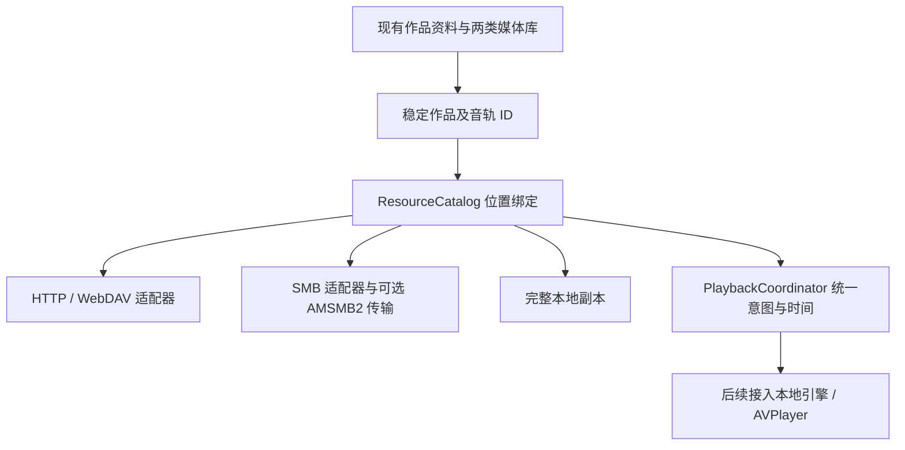

# 资源访问与统一播放控制：独立接口原型

2026-11-28 更新：本目录的协议适配器现已用于正式 App 的开发候选；当前接入范围以 [NAS 与整库备份](../../docs/NAS_AND_BACKUP.md) 为准。下文保留 2026-11-25 的原型设计与当时验证边界；其中“未接入”描述是历史状态。

日期：2026-11-25。基于正式仓库 `b7162d2`，独立分支 `codex/resource-access-interfaces`。本目录不在正式 App 的构建依赖中，没有修改、安装或发布正式 App。

这一步实现可以调用和测试的接口，不代表已经完成手机上的 NAS 流播功能。电脑/NAS 的 **SMB** 与 NAS 的 **HTTP/WebDAV** 同时保留；不要求用户部署专用媒体服务器。当前校园网无法做实际来源验证，因此真实兼容性继续待测。

## 产品规则

- 保留“个人”和“社团合集”两个库，仍按作品组织。连接只是文件来源，不成为第三个媒体库。
- 用户选择要导入的作品/文件夹及分类。接口只列举指定目录的直接子项，不自动扫描整台 NAS，不根据目录结构决定作品归属。
- 作品资料、封面、字幕、收藏和播放进度由现有本地业务库保存；资源目录只存位置绑定。断开或删除连接不删除作品身份及位置绑定。
- 一个 `workID + trackID` 可以绑定多个位置；换盘、换地址保留此身份。自动续播跨位置迁移必须有内容 SHA-256 证明；文件名、大小/时间、不同服务器上相同 ETag 都不足以证明同一内容。
- 不增加 EQ 或独立变调约束。保留本地完整文件/远程播放两类后端接口，后续可分别连接现有引擎与 AVPlayer。

## 模块与已实现范围



| 模块 | 本轮实现 | 尚未接入 |
|---|---|---|
| `ResourceAccessCore` | 来源配置、凭据引用、相对路径、元数据、能力三态、位置注册/重绑、快照序列化、完整副本原型 | 正式数据库迁移、封面/资料导入页面、系统文档提供器与书签适配 |
| `ResourceAccessHTTP` | 实际 URLSession HEAD、严格有界 Range、Basic/Bearer、WebDAV Depth 1、取消/超时/错误分类 | 所有 NAS 厂商兼容、Digest/NTLM、带查询签名地址、HEAD 不可用回退 |
| `ResourceAccessSMB` | 共享根目录与相对路径、凭据注入、单层目录、范围读取、版本检查、能力探测 | NAS 发现、连接池、服务器快照/单句柄完整下载 |
| `ResourceAccessAMSMB2`（另一个包） | 固定源码的本地修补版 SMB2/3 传输；本机目录/范围读取、认证与文件错误验证；分阶段诊断 | 真实电脑/NAS 与 SMB3 加密验收 |
| `PlaybackCoordination` | 单后端控制、意图/状态分离、最新定位优先、暂停与睡眠优先、过期结果丢弃、重连身份校验、媒体时间与收听统计接口 | 真正 AVFoundation 后端、认证/SMB 字节桥接、自动重试策略、现有 UI/队列/锁屏/后台/统计持久化接线 |

`supported / unsupported / unknown` 是针对具体能力的观察结果。能随机读取文件字节，不等于 MP3/M4A/WAV 都能准确定位；能得到远程 URL，也不等于已经验证 AVPlayer 播放。完整下载、断点续传和媒体 seek 不从协议名称推断。

## 调用示例

以下函数用于宿主代码中；凭据来自输入或 Keychain，不写入 URL、目录快照或日志。示例使用内存凭据容器，正式接入时可替换为 `KeychainCredentialStore`。

```swift
import Foundation
import ResourceAccessCore
import ResourceAccessHTTP

func registerDAV(password: String, catalog: ResourceCatalog) async throws {
    let credentials = InMemoryCredentialStore()
    let reference = CredentialReference()
    await credentials.set(.usernamePassword(username: "listener", password: password), for: reference)
    let source = try SourceConnection(
        kind: .webDAV,
        endpoint: URL(string: "https://nas.example.invalid/dav/Audio/")!,
        credentialReference: reference
    )
    let adapter = try HTTPResourceAdapter(connection: source, credentials: credentials)
    await catalog.register(adapter)

    // 仅在用户选择作品后绑定，不因注册连接而扫描/导入整库。
    let path = try ResourcePath("选定作品/01 音声.wav")
    await catalog.bind(.init(identity: .init(workID: 7, trackID: 11),
        locations: [.init(sourceID: source.id, path: path)]))
    let chunk = try await adapter.read(at: path,
        range: ByteRange(offset: 4096, length: 1024), expectedRevision: nil)
    _ = chunk // 协议字节，不是已经解码的音频。
}
```

在依赖可选桥接包的独立宿主中，SMB 使用同一个目录接口：

```swift
import Foundation
import ResourceAccessCore
import ResourceAccessSMB
import ResourceAccessAMSMB2

func registerSMB(password: String, catalog: ResourceCatalog) async throws {
    let credentials = InMemoryCredentialStore()
    let reference = CredentialReference()
    await credentials.set(.usernamePassword(username: "listener", password: password), for: reference)
    let source = try SourceConnection(kind: .smb,
        endpoint: URL(string: "smb://nas.example.invalid/Audio/选定根目录")!,
        credentialReference: reference)
    let adapter = try SMBResourceAdapter(connection: source,
        credentialProvider: credentials, transport: AMSMB2Transport(),
        requiresEncryption: true)
    await catalog.register(adapter)
    // 后续按用户选择调用 listChildren/read/bind，与 HTTP/WebDAV 使用相同合同。
}
```

`requiresEncryption: true` 需要服务器支持相应 SMB 加密；不满足时失败，不静默降级。HTTP 默认要求 HTTPS；测试 HTTP 要显式设置 `allowsInsecureHTTP: true`。TLS 使用系统验证，不跳过证书信任。Keychain 实现可编译，本轮未在手机上写入或验证真实凭据。

## 离线副本与身份保障

`OwnedResourceStore.copy` 是前台完整拷贝原型，不是 iOS 后台下载管理器：已知大小、显式容量上限、有界读取、临时文件、完成后原子登记。取消、短读、版本变化、旧请求晚到均不发布副本；新拷贝覆盖同音轨的进行中旧操作。播放器不会因为下载完成而在播放中自动换后端。

多块拷贝要求所有块及结束元数据保持一致强 ETag，或预先已知的完整 SHA-256。只知道大小/mtime 时不进行未经证明的多请求拼接；普通 SMB stat 不满足此条件，大文件离线下载仍需后续单句柄/快照方案或已知内容 hash。最终 hash 必须匹配已有预期值，不能将下载后新算的 hash 当成源文件始终一致的证明。

已登记副本重新使用时按块复核 SHA-256，拒绝等长损坏后的旧身份；这是保守原型，大文件验证耗时尚未优化/测量。旧完整副本暂不删除，避免破坏播放中的文件；配额、淘汰、崩溃遗留临时文件回收、暂停后持久续传和后台下载调度均待实现。

来源登记快照不含口令；Keychain 保存口令，快照只有不透明引用。重启恢复配置后需要重新构造适配器。`ResourceCatalog` 无权删除作品资料，但正式 App 的资料/封面离线浏览还需要数据库与导入流程接线，不能把接口测试当成现成功能。

## 统一控制规则

- `intent` 单独记录用户要播放/暂停/停止；`actualState` 记录准备、缓冲、播放、定位、重连、失败等实际状态。
- 每次载入/重连有新的 session，定位有 timeline 代次。旧响应不能覆盖新作品或新定位；真实后端也必须停止旧任务，单纯忽略回调不够。
- 定位串行，多个待处理位置只保留最后一个。恢复期间的暂停/睡眠停止继续生效，载入和 seek 本身不能偷偷自动播放。
- 重连重新解析来源；恢复定位失败仍保存目标供重试。错误留在当前作品，不自动切下一首。
- 字幕读取实际媒体时间，不使用拖动预览。收听时长只在媒体位置推进时累计，按墙钟和 `媒体推进/倍速` 较小值保守记账；缓冲、暂停、定位、冻结时钟不累计。这是媒体时间证据，不是声学测量。
- `.byteReader` 明确返回需要准备。SMB 和需要认证的 HTTP 必须接通 AVPlayer 资源桥接或取得完整本地文件，不能直接冒充可播放 URL。

## 验证与下一步

本轮结果与复现命令见 [VALIDATION.md](VALIDATION.md)。HTTP 专项边界见 [Fixtures/README.md](Fixtures/README.md)；SMB 原始失败、后续修补及 22 项通过记录见 [可选桥接说明](../ResourceAccessAMSMB2/README.md)。独立手机验证入口见 [LANResourceProbe](../LANResourceProbe/README.md)。

后续按依赖顺序：

1. 在可访问的电脑/NAS 上分别验收 SMB 与 HTTP/WebDAV：认证、UTF-8/空格路径、非零偏移、断网/重连、换内容和权限变化。SDK 的认证错误分类、断开清理与超时回调已在本地 vendor 修补并通过回环测试，原因及证据见 [SMB 诊断记录](../ResourceAccessAMSMB2/DIAGNOSTICS.md)。
2. 实现真实播放器后端及字节桥接，继续独立验证 MP3、M4A、WAV 的流播、拖动定位、断线续播、后台/锁屏和字幕同步；协议字节测试不能替代此项。
3. 验证通过后才接正式资料库、作品手动导入、来源重绑、离线下载管理及现有统一界面。无需整库自动扫描。

普通 HTTP/WebDAV 直接使用 Foundation，无新增第三方依赖；SMB 可选桥接固定 AMSMB2 源码，独立登记其与 libsmb2 的许可，尚未把依赖纳入正式发布包。
