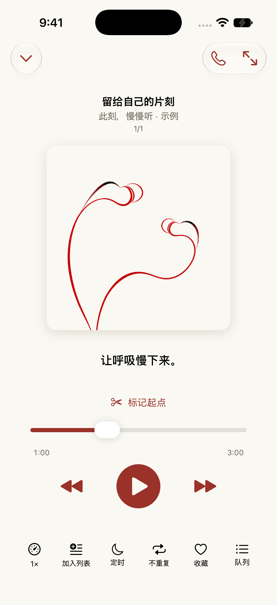
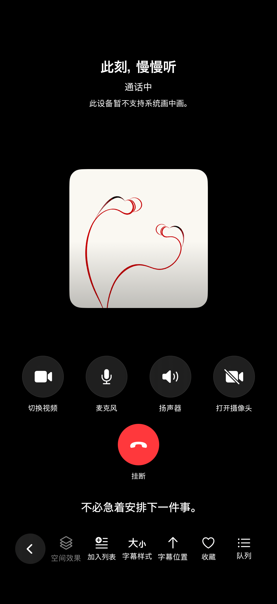
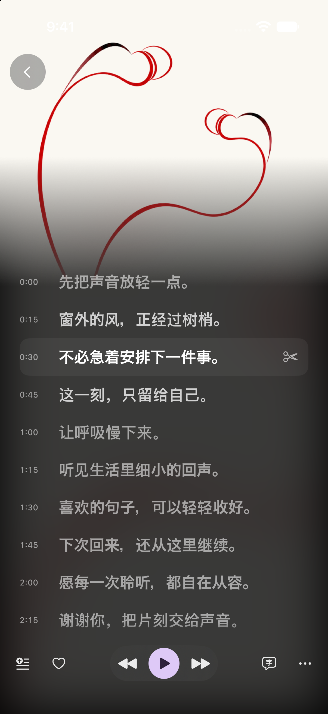
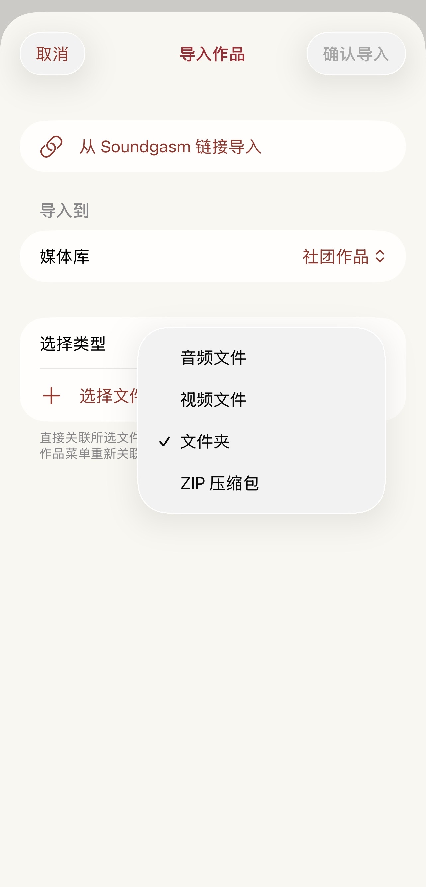
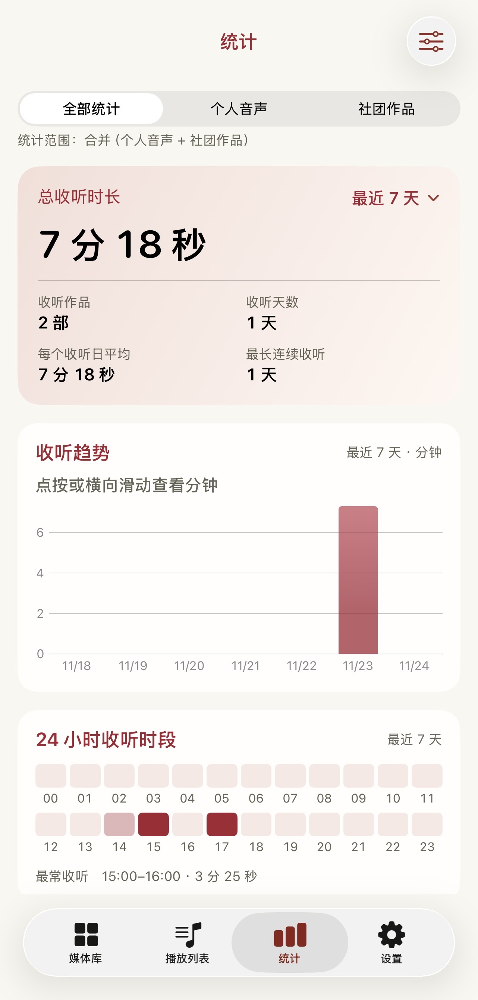
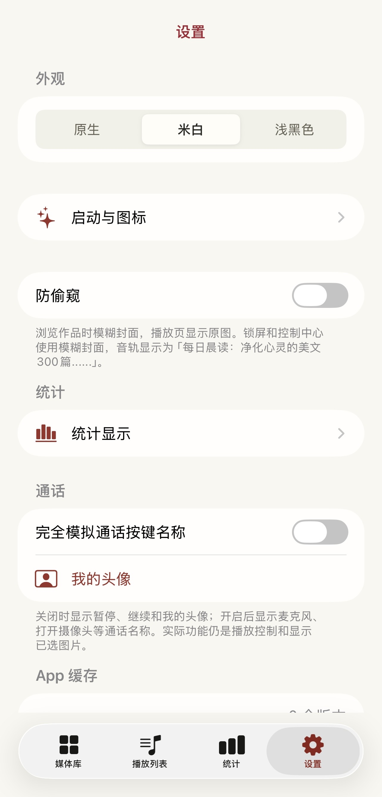
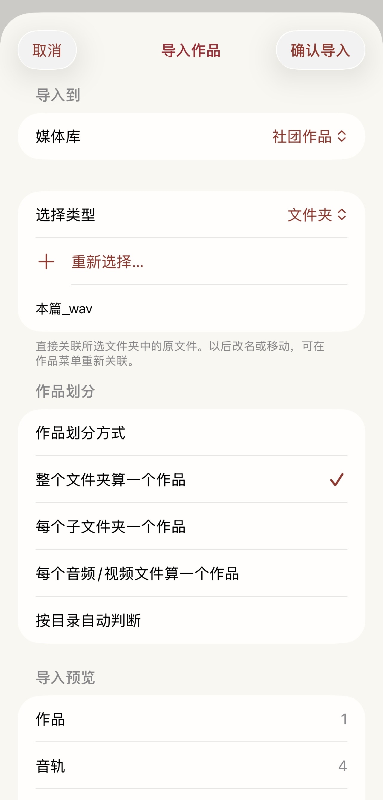
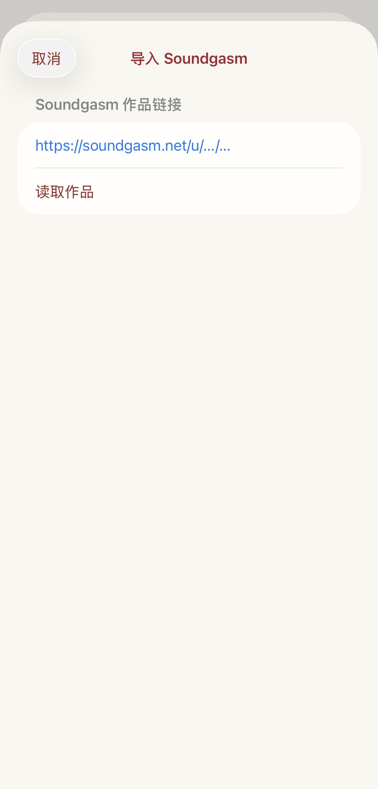
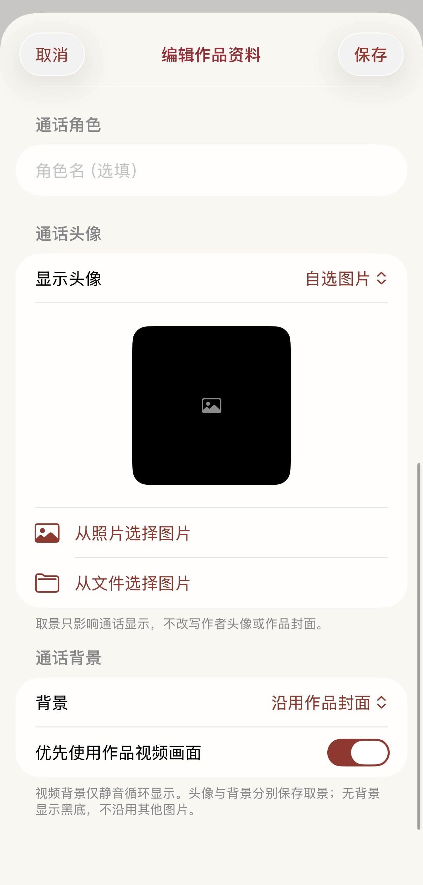
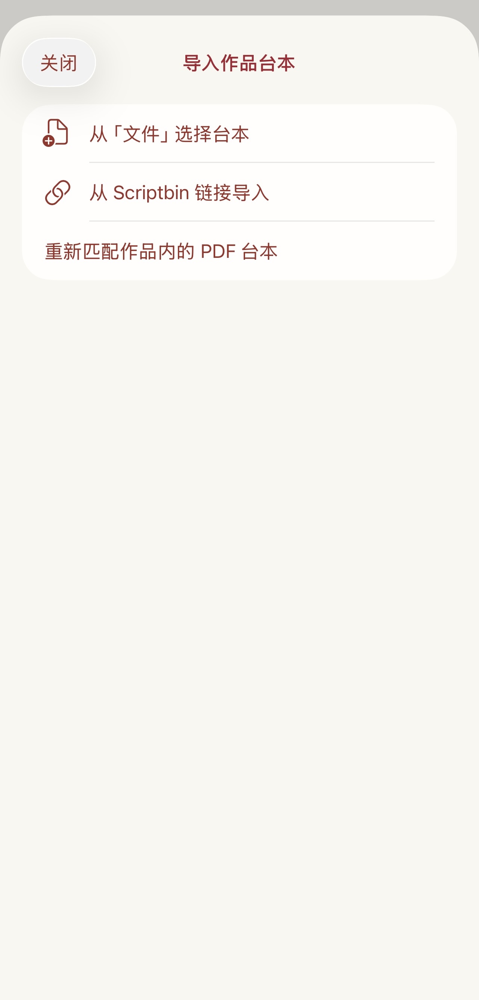

  

<h1 align="center">厮磨</h1>

<strong>把喜欢的声音，整理成一座属于自己的媒体库。</strong>

个人独立开发 · 全部功能免费 · 源码公开

  <a href="https://github.com/Reyanna0o0/Simo-soundplayer/releases/download/v0.1.4/simo-0.1.4-build37-unsigned.ipa"><strong>下载 IPA</strong></a> ·
  <a href="docs/INSTALL.md"><strong>查看安装方法</strong></a> ·
  <a href="https://github.com/Reyanna0o0/Simo-soundplayer/releases"><strong>版本更新</strong></a>

v0.1.4 · build 37 &nbsp; | &nbsp; iOS / iPadOS 18 或更新版本

<strong>简体中文</strong> · <a href="docs/i18n/zh-Hant/README.md">繁體中文</a> · <a href="docs/i18n/en/README.md">English</a> · <a href="docs/i18n/ja/README.md">日本語</a> · <a href="docs/i18n/ko/README.md">한국어</a>

厮磨是一款以作品整理与沉浸式播放为核心的 iOS 音声播放器。个人音声与社团作品分库管理，音频、视频、封面、台本和收听记录集中在同一个地方。无需注册账户，导入自己的收藏，就可以开始收听。

> **v0.1.4 · build 37：加入外放保护，并收紧后台恢复播放。** 内置扬声器默认静音，可在播放时调节系统音量或连接耳机解除；后台被其他声音打断后保持暂停，需主动继续。沿用原账户与签名设置覆盖安装，**不要先卸载**。 [更新说明](docs/RELEASE_BUILD37.md)

> **本地开发候选 0.1.5 · build 38：NAS 与整库备份。** 此分支新增设置入口，手动导入 SMB/WebDAV/HTTP 音频，以及 App 内资料和媒体的备份/恢复。上方下载仍指向已发布的 0.1.4；候选功能与真机清单见 [NAS 与整库备份](docs/NAS_AND_BACKUP.md)。

## 从导入到收听，只需三步

| 导入作品 | 整理作品 | 开始收听 |
| --- | --- | --- |
| 选择音频、视频、文件夹、ZIP，或粘贴 Soundgasm 单作品链接。 | 按目录与文件划分作品，补充封面、创作者、台本和分类。 | 在普通播放、通话外观与全屏字幕之间，找到舒服的收听方式。 |

## 三种方式，听同一份喜欢

<table>
  <tr>
    <th align="center">普通播放</th>
    <th align="center">沉浸通话</th>
    <th align="center">全屏字幕</th>
  </tr>
  <tr>
    <td align="center"></td>
    <td align="center"></td>
    <td align="center"></td>
  </tr>
  <tr>
    <td valign="top">倍速、音调、均衡、循环、睡眠定时与队列，也可以在后台和锁屏控制播放。</td>
    <td valign="top">按作品设置角色、头像与背景，切换语音或视频通话外观，让画面更贴合作品。</td>
    <td valign="top">边听边读，调整原文与译文的显示；也能编辑字幕、手动打轴或打开字幕浮窗。</td>
  </tr>
</table>

三张示例均为模拟器中的 App 实拍，使用虚构作品和原创演示内容，不引用实际音声作品。画中画的可用性取决于设备；通话图保留了模拟器的系统提示。通话外观用于本地媒体播放，不发起真实通话；此模式不提供倍速等普通播放器调节。[播放与通话说明](docs/USAGE.md#播放与通话)

## 让收藏有条理，让习惯看得见

<table>
  <tr>
    <th align="center">从不同来源导入</th>
    <th align="center">记录自己的收听轨迹</th>
    <th align="center">按自己的习惯使用</th>
  </tr>
  <tr>
    <td align="center"></td>
    <td align="center"></td>
    <td align="center"></td>
  </tr>
  <tr>
    <td valign="top">音频、视频、文件夹与 ZIP 都能导入。确认前预览作品和音轨，选择保存至个人音声或社团作品。</td>
    <td valign="top">查看总时长、作品数、收听天数、每个收听日平均与连续记录。两个库可分开或合并统计，时长保留秒数。</td>
    <td valign="top">原生、米白、浅黑色、紫色四种外观；可调整启动图标、开屏语音、统计显示和通话按键名称。</td>
  </tr>
</table>

设置截图展示前三个外观选项，紫色可横向滑动选择。防偷窥模式会模糊浏览时的封面，并在锁屏和控制中心模糊封面、替换音轨标题及隐藏作品／作者资料；播放页仍显示原图。

### 外放前，多一层确认

**外放保护默认开启**，可在「设置 → 外放保护」关闭。使用设备内置扬声器时，普通音频、视频、通话与开屏语音先保持静音；播放时调节系统音量、点「允许本次外放」，或把输出切换到耳机即可解除。暂停后重新播放或切回扬声器时再次保护。它只静音厮磨，不改系统音量，也不会让已暂停的内容自动播放。音量已在最高或最低、按键未改变音量时，可使用「允许本次外放」。

App 在后台或未处于活动状态时，中断结束后保持暂停；需主动点击播放。前台只有此前正在播放同一曲目、期间未手动暂停且系统允许时才会恢复。[使用说明](docs/USAGE.md#外放保护与中断后播放build-37-起)

### 一个文件夹，多种整理方式

文件夹和 ZIP 导入支持四种作品划分：**整个文件夹、每个子文件夹、每个音频／视频文件，或按目录自动判断**。单独选择音频或视频时，每个文件建立一部作品。

单独导入的音视频会复制进 App；文件夹导入保留外部关联。外部文件夹改名或移动后，可在作品菜单重新关联新位置，继续使用已有资料和字幕版本。[导入与重新关联](docs/USAGE.md#导入作品)

查看作品划分与导入预览

### 链接里的声音，也能收进媒体库

粘贴 **Soundgasm 单作品链接**，读取并确认资料，再下载音频副本。保存后的音频可以离线收听；读取网页和下载时需要联网。[链接导入步骤与支持范围](docs/USAGE.md#从链接导入)

查看 Soundgasm 导入入口

### 让播放画面更贴合作品

除了作品封面，还可以分别设置**通话角色、头像、背景与取景**。沿用封面、自选图片，或优先使用作品中的视频画面；头像与背景分别保存，不改写原作品封面。视频背景以静音循环显示，静态背景还可启用本机处理的空间效果。

查看头像与背景设置

### 把台本和作品放在一起

从“文件”选择台本、从 **Scriptbin** 链接提取并确认正文，或重新匹配作品内的 PDF。带时间标记的 SRT、LRC 等字幕可以跟播；无时间标记的台本可以阅读，也可以逐句手动打轴，编辑会保存为新版本。

如果同时导入原文和译文，可以配对并上下显示。**厮磨不提供自动翻译，原文与译文由你导入。** [台本、字幕与打轴](docs/USAGE.md#字幕与台本)

查看台本导入入口

### 留下喜欢的片段，也留下收听的足迹

把准备连听的曲目加入播放列表，用剪刀标记喜欢的起点和终点，保存为独立摘选；片段可保留字幕、拼接，并导出 MP3 或 WAV。列表与分类支持排序和移动。

月度回顾、年度报告整理收听时长、足迹和排行，也可导出连续长图，保存属于自己的收听记录。

[播放列表与摘选](docs/USAGE.md#播放列表与摘选) · [统计与报告分享](docs/USAGE.md#统计外观与语言)

## 全部功能免费，源码公开

厮磨的全部功能对个人非商业使用免费开放。你可以自愿赞助开发；赞助不会解锁额外权益、专属功能或付费内容，也不等于获得商业授权。

**[通过 Stripe 支持](https://donate.stripe.com/7sYcN4ctY5GM3rK3oM7ok00) · [通过爱发电支持](https://afdian.com/a/Reyanna0o0)**

项目采用自定义的**厮磨播放器非商业源码许可协议 1.0**，并非 MIT、GPL 或 OSI 认证的开源许可。允许依协议免费使用、修改和分享；分享修改版须保留署名、提供完整对应源码并标明非官方。所有商业使用须事先取得书面同意。[许可全文](LICENSE) · [商业授权](docs/COMMERCIAL_USE.md)

## 安装与更新

目前通过自签方式安装，不是 App Store 下载。

1. 在电脑上[下载 IPA](https://github.com/Reyanna0o0/Simo-soundplayer/releases/download/v0.1.4/simo-0.1.4-build37-unsigned.ipa)，准备 Sideloadly 等签名工具和自己的 Apple 账户。
2. 用数据线连接 iPhone / iPad，按[安装教程](docs/INSTALL.md)完成签名与安装。
3. 如系统提示，前往“设置 → 通用 → VPN 与设备管理”信任开发者，并按教程开启开发者模式。

更新或续签时，沿用原 Apple 账户、应用标识与签名设置覆盖安装，**保留原 App，不要先卸载**。签名有效期、续签和不同安装方式的注意事项请看完整说明。

[下载帮助](docs/DOWNLOAD.md) · [安装、续签与更新](docs/INSTALL.md) · [对应源码 ZIP](https://github.com/Reyanna0o0/Simo-soundplayer/releases/download/v0.1.4/simo-0.1.4-build37-source.zip) · [实际验证范围](docs/RELEASE_STATUS.md)

## 数据与内容由你掌握

媒体库、字幕版本、播放列表、摘选与收听记录保存在设备上，没有项目方的云端媒体库或多设备同步。链接导入需要访问相应网站；iCloud Drive、系统备份和导出到云盘由系统及服务提供方按你的设置处理。

请另外保留重要原文件。安装包不附带音声作品或台本，示例截图也不代表附赠内容；请导入你有权使用的媒体，分享摘选、字幕或报告时留意其中的作品资料。[文件保留与缓存](docs/USAGE.md#缓存与数据保留)

## 反馈与后续计划

发现 Bug，或对功能和界面有新的想法，欢迎通过 [GitHub Issues](https://github.com/Reyanna0o0/Simo-soundplayer/issues) 反馈。描述设备系统、App 版本和复现步骤，截图中请遮住私人作品与账户信息。[提交 Bug](https://github.com/Reyanna0o0/Simo-soundplayer/issues/new?template=bug-report.yml)

目前提供 iOS / iPadOS 版本。后续更新与 Android 适配计划会在 GitHub 记录，**Android 版暂无发布时间表**。点击 **Star** 收藏项目；需要更新通知时，可在 **Watch → Custom → Releases** 中订阅发行版。

想参与改进，可以先阅读[构建说明](docs/BUILD.md)、[验证记录](docs/RELEASE_STATUS.md)和[历轮修复说明](docs/AI_REVIEW_FIXES.md)，通过 Issues 交流后提交修改。

开发目录与素材署名

| 目录 | 用途 |
| --- | --- |
| `SituationVoicePlayer/` | SwiftUI App、资源与 Xcode 工程 |
| `hibiki/` | HibikiCore、数据库、字幕逻辑与自检 |
| `ThirdParty/` | 第三方源码、模型来源与许可 |
| `scripts/` | 资源核验、构建、测试与 IPA 打包 |
| `tools/localization/` | 既有五语翻译目录与生成工具 |

图标与开屏创意来自 Reyanna0o0，手绘修改由友人协助并已授权，底图与动效由 ChatGPT 辅助生成。展示截图及示例内容的来源另有记录，不使用真实音声作品作为演示。

第三方组件保留各自许可；适用的 LGPL 修改、调试、替换及重新链接权利保留。分发含 LGPL 组件的安装包时，请同时提供对应源码和重建材料。

[素材说明](docs/ASSETS.md) · [第三方材料](docs/THIRD_PARTY.md) · [商业授权申请](https://github.com/Reyanna0o0/Simo-soundplayer/issues/new?template=commercial-license.yml) · [开发者邮箱](mailto:sumo-soundplayer@outlook.com)

---

<strong>把喜欢的声音，收进厮磨。</strong>

<a href="https://github.com/Reyanna0o0/Simo-soundplayer/releases/download/v0.1.4/simo-0.1.4-build37-unsigned.ipa">下载 IPA</a> · <a href="docs/INSTALL.md">查看安装教程</a> · <a href="https://github.com/Reyanna0o0/Simo-soundplayer">在 GitHub 收藏项目</a>

