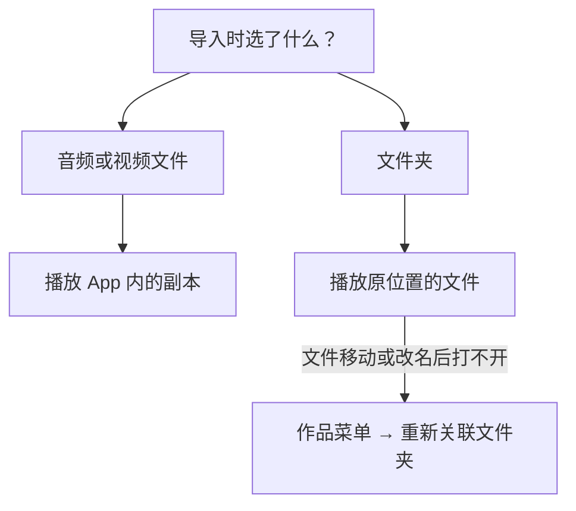
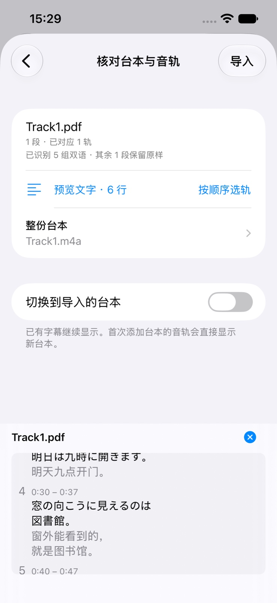
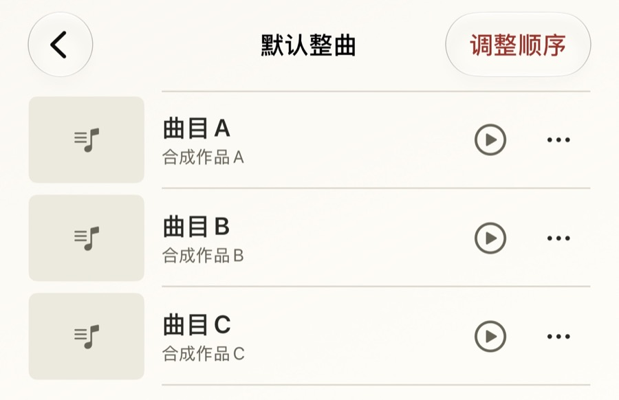
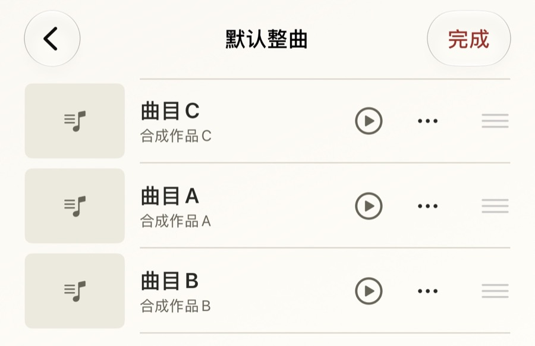

# 厮磨使用手册

装好厮磨后，可以先用一段能找回原件的音频走一遍导入、播放和摘选。下面的界面示例使用测试资料。

[导入与重新关联](#导入作品) · [网页链接](#从链接导入) · [播放与通话](#播放与通话) · [字幕与台本](#字幕与台本) · [列表与摘选](#播放列表与摘选) · [统计与设置](#统计外观与语言)

还没把 App 装到手机上？从[下载 IPA](DOWNLOAD.md)和[签名安装](INSTALL.md)开始。

## 导入作品

1. 打开底部的「媒体库」，点右上角 **「＋」**，进入「导入作品」。
2. 在「导入到」选库。多轨作品可选**社团作品**，以后按社团或声优查看。单条音频或同一作者的收藏可选**个人音声**，并在这里选已有创作者或新建一位。
3. 选导入类型和文件。导入文件夹或 ZIP 时，可以让整个目录成为一个作品，也可以按子文件夹、每个媒体文件或自动判断来划分。
4. 核对「导入预览」中的作品、音轨和视频数量，再点「确认导入」。回到媒体库打开一部作品，播放一条音轨看看。

| 你选择的来源 | 厮磨从哪里播放 |
| --- | --- |
| 单独选择音频或视频文件 | 每个文件建立一个作品，在 App 内播放复制后的文件 |
| 文件夹 | 记住原文件夹和文件位置，播放时从那里读取 |
| 普通 ZIP | 解压后预览，确认导入后使用 App 保存的解压文件。密码 ZIP 和分卷包暂不支持 |
| Soundgasm 链接 | 下载完成后播放 App 内的音频副本 |

音视频能否播放取决于文件中的编码。AVI 兼容处理只覆盖部分能重新封装的文件。

### 搬动了原文件怎么办

如果当初是**选文件夹**导入，之后移动或改名可能会让旧关联失效。进入作品详情，选 **「…」→「重新关联文件夹」**。从个人音声的作品卡出发，也可以选「… → 重新关联文件 → 修复外部文件夹位置」。

在「文件」中选新目录，逐项核对原音轨和附件与新位置的对应。App 预选的同名文件也要看一眼，改过名字的文件可手动指定。点「确认关联」，回到作品试播。

重新关联更新的是现有作品的文件位置，作品资料、字幕版本、阅读位置和分组顺序继续保留。单独导入并已复制进 App 的文件，移动外面的原件后仍可播放 App 内那份。如果文件在 iCloud Drive 等位置，先在「文件」里确认能打开或下载，再回厮磨关联。

## 从链接导入

### Soundgasm：下载音频并建立作品

1. 打开「媒体库 → ＋ → 从 Soundgasm 链接导入」。
2. 粘贴单个作品页面的完整链接（`soundgasm.net/u/账号/作品`），点「读取作品」。
3. 核对标题、来源和要存入的库，再点「下载并导入」。下载完成后，到对应媒体库打开作品。

### Scriptbin：给已有作品加一份台本

1. 在作品菜单选「导入作品台本 → 从 Scriptbin 链接导入」，粘贴单个台本的完整链接（`scriptbin.works/u/账号/作品`），点「打开台本网页」。
2. 按网页要求确认访问，看到正文后点 App 的「提取正文」。在「核对正文」页预览文本，然后点「选择音轨」。
3. 配到对应的音频，再点「导入」。保存后可以离线阅读，之前导入的台本与编辑版本会继续保留。

两个入口都需要在导入时联网，当前接受相应站点的单作品页面地址。首页、账号页、Scriptbin 短链或需要登录的内容可能无法读取。如果网页确认后仍未显示正文，可以把有权使用的台本保存为本地 TXT，再按下节导入。

## 播放与通话

| 想做什么 | 从哪里开始 |
| --- | --- |
| **普通播放** | 在「媒体库」选曲目播放，点底部迷你播放器即可展开。可跳到指定位置，查看和调整当前队列、循环、倍速、音调、均衡、淡入淡出或睡眠定时 |
| **全屏字幕** | 在音频播放页点右上角的全屏字幕图标。有时间的台词可跟随播放并点按跳转，无时间的台本可以滚动阅读。在字幕菜单中也可打开字幕浮窗 |
| **模拟通话** | 在播放页点电话图标进入，用通话里的按钮在模拟语音和视频界面之间切换。挂断会结束模拟场景并暂停播放 |

普通音频支持后台和锁屏控制。作品详情中的视频可直接打开播放器，具体画中画能力取决于设备和媒体。模拟通话的麦克风和摄像头样式按钮用来控制播放、显示预先选好的图片，不会拨打电话或连接其他人。

### 外放保护与中断后播放（build 37 起）

「设置 → 外放保护」默认开启，可按自己的习惯关闭。它只控制厮磨自身的静音，不调整设备系统音量，覆盖普通音频、正式视频、视频附件预览、通话模式和开屏语音。

- 使用设备内置扬声器开始播放时，先静音。播放期间调节系统音量，或点「允许本次外放」，即可允许当前这次外放；输出切换到耳机时也会解除静音。
- 暂停后重新开始播放、音频中断后重新播放，或从耳机切回扬声器，都会再次保护。同一次持续播放中的正常换曲不需要重新确认。
- 音量已在最高或最低时，继续按同方向音量键不会产生变化，可改按反方向，或使用「允许本次外放」。系统可能在切换输出时自动恢复该输出的音量；刚开始播放或切换输出后的约 0.75 秒内不把这种变化当作解除许可，可稍后再调节或直接点允许按钮。
- 连接耳机、调整音量和解除静音都不会启动已暂停的曲目。耳机断开仍会暂停；需要主动继续。
- App 在后台或非活动状态时，中断结束后保持暂停，也不会等回到前台后自行恢复。需要点击 App、锁屏、耳机或画中画的播放控制继续。前台仅在同一曲目此前确实正在播放、没有新的手动暂停且系统允许恢复时，才自动继续。

繁體中文 · English · 日本語 · 한국어

**繁體中文**

**外放保護預設開啟**，可在「設定 → 外放保護」關閉。使用裝置內建揚聲器時，一般音訊、影片、通話與開屏語音先保持靜音；播放時調整系統音量、點「允許本次外放」，或將輸出切換到耳機即可解除。暫停後重新播放或切回揚聲器時再次保護。它只靜音廝磨，不改系統音量，也不會讓已暫停的內容自動播放。音量已在最高或最低、按鍵沒有改變音量時，可使用「允許本次外放」。

App 在背景或非活動狀態時，中斷結束後保持暫停，需主動播放。前景僅在先前正播放同一曲目、期間未手動暫停且系統允許時恢復。

**English**

**Speaker protection is on by default** and can be turned off in Settings. On built-in speakers, audio, video, call-mode playback and launch audio start muted. During playback, change the system volume, tap **Allow speaker audio**, or switch output to headphones to unmute. Protection resets after a pause and restart, or when returning to the speakers. It mutes only Simo, never changes system volume, and never resumes paused content. If a volume key has no effect at the upper or lower limit, use **Allow speaker audio**.

When the app is in the background or inactive, interruption endings leave playback paused until you resume it. In the foreground, automatic resumption is allowed only for the same previously playing item, with system permission and no intervening user pause.

**日本語**

**スピーカー再生の保護は初期設定でオン**です。「設定」でオフにできます。本体スピーカーでは、音声・動画・通話モード・起動時の音声が消音状態で始まります。再生中にシステム音量を調節するか、**「今回のスピーカー再生を許可」**を押すか、出力をヘッドフォンに切り替えると解除できます。一時停止後の再開時やスピーカー出力に戻ったときは、再び保護されます。Simo の音だけを消音し、システム音量は変更しません。消音を解除しても一時停止中の内容は自動再生されません。音量が最大・最小でキーを押しても変わらない場合は、許可ボタンを使えます。

アプリがバックグラウンドまたは非アクティブの間に中断が終了した場合は、一時停止を維持します。前面では、中断前に同じ項目を再生しており、手動で一時停止されず、システムが許可した場合に限り自動再開します。

**한국어**

**스피커 재생 보호는 기본적으로 켜져 있으며** 설정에서 끌 수 있습니다. 내장 스피커에서는 일반 오디오, 동영상, 통화 모드와 시작 음성이 음소거 상태로 시작됩니다. 재생 중 시스템 음량을 조절하거나 **「이번 스피커 재생 허용」**을 누르거나 출력을 헤드폰으로 전환하면 해제됩니다. 일시 정지 후 다시 재생하거나 스피커로 돌아오면 보호가 다시 적용됩니다. Simo만 음소거하며 시스템 음량은 바꾸지 않고, 일시 정지된 콘텐츠를 자동으로 재생하지도 않습니다. 음량이 최대·최소라 같은 방향의 키를 눌러도 변하지 않으면 허용 버튼을 사용할 수 있습니다.

앱이 백그라운드에 있거나 비활성 상태일 때 중단이 끝나면 일시 정지를 유지합니다. 포그라운드에서는 이전에 같은 항목을 재생 중이었고, 사용자가 중간에 일시 정지하지 않았으며, 시스템이 허용한 경우에만 자동으로 재개합니다.

### 作品资料与通话设置

从作品的 **「…」→「编辑作品资料」** 进入。名称、播放器封面显示、社团/声优或创作者归属都在这里。个人音声可在创作者资料中管理共享的头像和封面。

build 35 起，编辑创作者时，从照片或文件选择头像后会打开「裁剪头像」。拖动图片调整位置，双指或滑块缩放，圆形框内是头像显示范围；「复位」回到居中初始范围。点「使用」回到编辑页，再点「保存」完成。取消裁剪保留当前头像，取消整个编辑页则放弃本次修改。

同一编辑页里，找到「通话角色」，选择显示的角色名称、头像、背景或视频画面，必要时调整取景，最后点「保存」。静态图片可启用空间效果，图片深度在设备上处理。个人音声可在创作者资料设一套常用通话外观，也可为单部作品单独设置。自己的显示图片可在「设置」的「通话」区点「我的头像」设置。

## 字幕与台本

| 你手里的文件 | 导进去后能做什么 |
| --- | --- |
| SRT、VTT、LRC 等有时间轴的字幕 | 读取文件里的时间，按播放进度显示相应台词 |
| 带有可识别时间标记的 PDF / TXT 台本 | 配到音轨并核对预览后，识别到的台词按原文时间跟播 |
| 没有时间标记的台本 | 直接看文字，或手动给需要的句子设时间 |
| 已有的原文和译文 | 尝试配成双语字幕，可选看原文、译文或两者。请在预览确认配对 |

厮磨可以利用已有时间标记和译文，**没有自动翻译，也不会听音频生成台词或推算没有标记的时间轴**。

### 导入台本并核对音轨

1. 打开作品的「…」，选「导入作品台本」，再从作品附件或「文件」中选择 PDF / TXT。文件夹导入时，放在同目录、与音轨同名的字幕也会参与自动匹配。
2. 到「核对台本与音轨」时，点「预览文字」。检查台词、已有时间、双语是否对应，也检查下面列出的音轨；需要时手动换轨。PDF 应有可读取的文字，图片扫描版可先准备文本再导入。
3. 有旧字幕时，想马上看到新台本可以打开「切换到导入的台本」。确认后点右上角「导入」。想为单条音轨选带时间的字幕文件，也可以用那条音轨菜单的「导入字幕文件」。

*示例里台本已有 `0:30–0:37` 的时间，原文和译文也都在导入文件中。确认这份台本配到了 Track1，点蓝色「×」收起预览，再点右上角「导入」。*

### 手动打轴或改错字

1. 播放对应音轨，进入「全屏字幕」。点没有时间的台词，或长按已经对过轴的台词，打开该句的详细编辑。
2. 修改原文、译文，或打开「设置时间」，按这句在音轨里的位置填写开始和结束时间。只设开始时间时也可用「自动结束」。点「从这句开始播放」试听。
3. 点「保存」，或用「保存并下一句」继续校对。修改会存为版本。需要备份或继续在别处编辑，可以从字幕菜单导出字幕文件。

如果每句都统一早了半秒或晚了半秒，可先调字幕整体时间偏移，再改个别句子。导入新台本前保留原文件，核对新版本后再决定用哪份。

## 播放列表与摘选

想做一份连续播放的清单，在播放器里点「加入列表」并选择分类。想留下其中一段，播放到开始处时点剪刀的「标记起点」，到结束处点「标记终点」，再核对范围并保存为摘选。也可以拼接片段。

在底部「播放列表 → 摘选」找到已保存的片段，用「… → 导出音频」存一份 MP3（默认）或 WAV。导出另存一个文件，App 内的摘选仍可继续播放。

### 调整分类里的顺序（build 33 起）

1. 点底部“播放列表”，再选择上方“播放列表”或“摘选”。
2. 打开要整理的分类，点右上角“调整顺序”。
3. 按住条目右侧的三横线把手，向上或向下拖动到想要的位置。
4. 点“完成”退出整理。每次拖动都会保存，重新打开 App 后仍保留该顺序；下次从这里开始播放时，按调整后的列表建立播放队列。

*先点第一张图右上角的「调整顺序」，再按住第二张图中曲目最右边的三横线拖动。要更改分类，点条目旁边的「…」。*

### 把曲目或摘选移到另一个分类

1. 打开原分类，点目标条目右侧的“…”（更多）。
2. 选择“更改分类”，再点要移入的分类。
3. 条目会从原分类移到目标分类的末尾。整曲只显示播放列表，摘选只显示摘选分类；当前位置会有勾选标记。

移动保留条目原有的音频引用、摘选字幕和创建记录。如果目标分类已有同一首整曲或视频，会提示“目标分类中已存在这首曲目或视频”，两边均保持原样。摘选菜单继续提供“导出音频”和“移除”。

## 整理创作者、声优与社团（build 33 起）

在个人音声库打开“创作者”，或在社团作品库打开“声优”/“社团”。点列表上方的“调整顺序”，按住右侧三横线把手拖动，最后点“完成”。三个列表分别保存顺序，互不影响；重启后保留。只有一个条目时无需排序，按钮会置灰。

## 统计、外观与语言

打开底部「统计」，可以查看总时长、收听趋势、24 小时分布、最长连续收听和排行。点总收听时长旁的日期选项，可以改看不同周期。从「设置 → 统计显示」可选择两个库的统计合并或分开、显隐组件及调整顺序。这里的显示开关只改变页面显示。

进入「月度回顾」或「年度报告」，按月份或年份回看记录，点「查看完整排行」展开更多条目。用分享按钮生成长图，可通过系统分享或保存到相册。报告使用厮磨资料库中的收听数据。全新且未恢复任何资料的安装从空白开始；覆盖更新、系统迁移或恢复已有资料时，可能保留原记录。

### 开屏语音与外观

想让喜欢的一句成为开屏语音，进入 **「设置 → 启动与图标 → 开屏语音」**，从媒体库音轨或已保存的摘选选择，点「试听（最多 10 秒）」先听。默认无声；启用后在冷启动时从所选内容开头最多播 10 秒。可以随时点「设为无声」。开屏声音不计入收听统计；外放保护开启时，内置扬声器上的开屏语音也会先静音。

「设置 → 外观」可切换原生、米白、浅黑色或紫色。「防偷窥」可以在浏览和锁屏时模糊封面，播放页仍可看原图。界面语言可跟随系统，也可单独选择简体中文、繁体中文、日文、英文或韩文。

## 缓存与数据保留

[0.1.5（build 38）测试版](https://github.com/Reyanna0o0/Simo-soundplayer/releases/tag/v0.1.5-beta.1) 提供 NAS 与整库备份入口；[0.1.4 稳定版](https://github.com/Reyanna0o0/Simo-soundplayer/releases/tag/v0.1.4) 仍可下载，不含这两项新功能。范围与限制见 [NAS 与整库备份](NAS_AND_BACKUP.md)。

“设置 → App 缓存”可以清理可清理的字幕旧版本和图片空间效果缓存。字幕清理保留原始、当前、固定和未完成编辑引用的版本；确认删除的其他历史版本不能恢复。图片空间缓存可重建，原图与取景设置保留。

请另行保留原始媒体、字幕和重要导出文件。续签、更新时保留原 App，用原账户与应用标识覆盖更新。[安装与更新说明](INSTALL.md)

**测试版换机顺序**　保留旧机 App → 覆盖更新到 build 38 → 设置中导出整库备份 → 把 `.simobackup` 保存到旧机以外 → 新机签名安装兼容版本 → 选择备份并校验、确认恢复 → 按提示关闭重开并逐项核对。恢复是整库替换，不合并；新机独有资料要先另备份，同一套作品不要重复手动导入。App 内媒体随备份保存，外部文件夹／NAS 音频不复制，需要保留原文件并重新授权或连接。

已有核心和模拟器检查；当前真机反馈仅确认旧、新机安装后可打开使用，尚未确认整库恢复完成。重新安装后若出现旧作品，可能是迁移或保留的资料；作品记录与源文件独立，目录刷新失败不能据此认定 IPA 自带数据或媒体已丢失。保留旧机 App 和备份，按 [换机与无法启动排查](MIGRATION.md) 分别核对。

繁體中文 · English · 日本語 · 한국어

- **繁體中文**　0.1.5（build 38，`v0.1.5-beta.1`）為 NAS／整庫備份測試版，0.1.4 仍為穩定版且沒有這些入口。保留舊機 App → 覆蓋更新 → 設定匯出 → 備份移出舊機 → 新機簽名安裝 → 校驗、確認還原並重開核對。還原會整庫取代、不合併；新機獨有資料先另備份，相同作品不要重複匯入。外部／NAS 音訊需保留原檔並重新連接。真機目前只確認安裝和開啟，尚未確認整庫還原完成。舊作品可能來自保留／移轉的資料；目錄失聯不代表 IPA 帶有作品或檔案已遺失。[完整步驟](MIGRATION.md#测试版换机流程)
- **English**　0.1.5 (build 38, `v0.1.5-beta.1`) is the NAS/full-library-backup beta; 0.1.4 remains stable without these entries. Keep the old app → update in place → export in Settings → move the backup off the old phone → sign and install on the new phone → validate, confirm restore, reopen and check. Restore replaces the whole library, without merging. Back up data unique to the new phone first; do not import the same works again. Keep and reconnect external/NAS media separately. Physical-device feedback confirms installation and opening only, not a completed full restore. Old works may be retained or migrated records; unavailable folders do not establish that the IPA contains them or that files are lost. [Full steps](MIGRATION.md#测试版换机流程)
- **日本語**　0.1.5（build 38、`v0.1.5-beta.1`）は NAS／全体バックアップのテスト版で、0.1.4 はこれらの項目がない安定版です。旧 App を保持 → 上書き更新 → 設定から書き出し → 旧端末以外に保存 → 新端末で署名・インストール → 検証・復元確認・再起動後の確認の順に進めます。全体を置き換え、統合しません。新端末だけの資料は先に別途バックアップし、同じ作品を重複して読み込まないでください。外部／NAS メディアは元ファイルを保管し再接続します。実機ではインストールと起動のみ報告され、全体復元は未確認です。旧作品は保持・移行済みの記録の場合があり、フォルダへのアクセス失敗だけでは IPA 内の作品やファイル消失を判断できません。[詳しい手順](MIGRATION.md#测试版换机流程)
- **한국어**　0.1.5(build 38, `v0.1.5-beta.1`)는 NAS/전체 백업 테스트 버전이며 0.1.4는 해당 메뉴가 없는 안정 버전입니다. 기존 앱 유지 → 덮어쓰기 업데이트 → 설정에서 내보내기 → 기존 휴대폰 밖에 백업 저장 → 새 기기에 서명·설치 → 검증 및 복원 확인 → 재실행 후 확인 순서로 진행하세요. 전체 교체이며 병합하지 않습니다. 새 기기에만 있는 자료는 먼저 별도 백업하고 같은 작품을 중복으로 가져오지 마세요. 외부/NAS 미디어는 원본을 보관하고 다시 연결해야 합니다. 실기기는 설치·실행까지만 확인되었으며 전체 복원 완료는 미확인입니다. 기존 작품은 유지·이전된 기록일 수 있으며, 폴더 접근 실패만으로 IPA에 작품이 있다거나 파일이 사라졌다고 판단할 수 없습니다. [전체 절차](MIGRATION.md#测试版换机流程)

