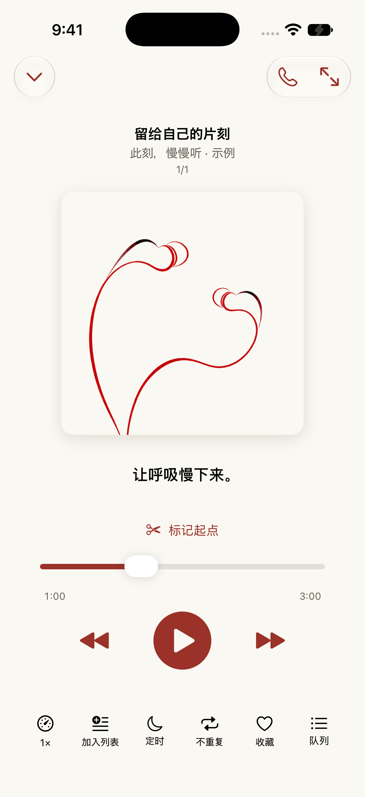
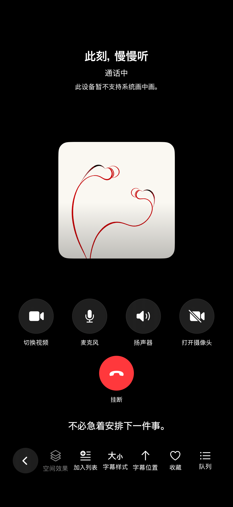
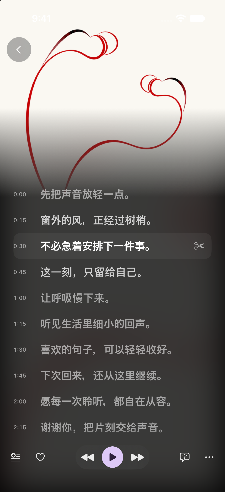
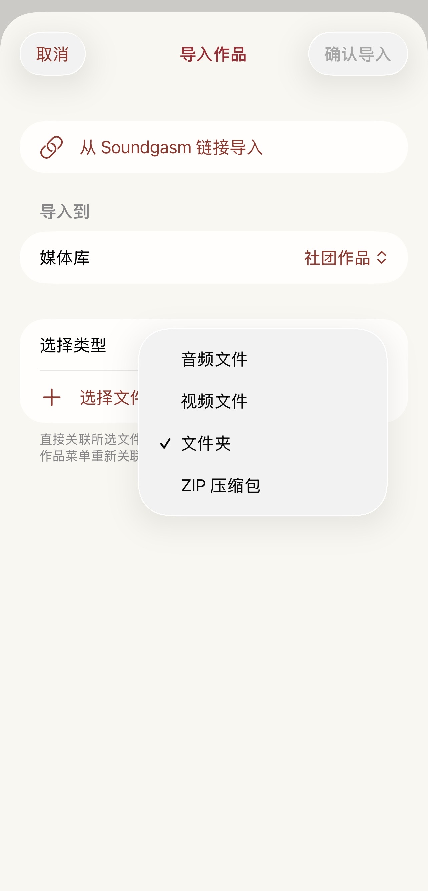
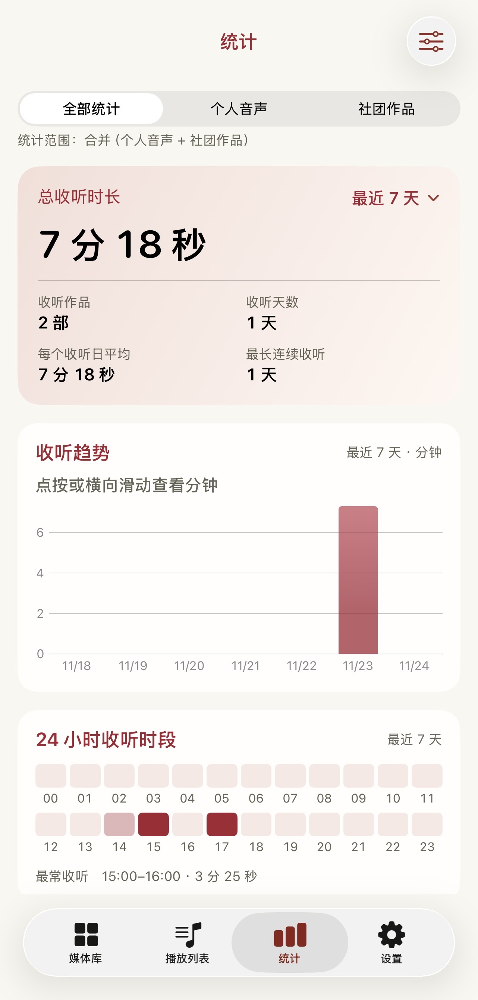
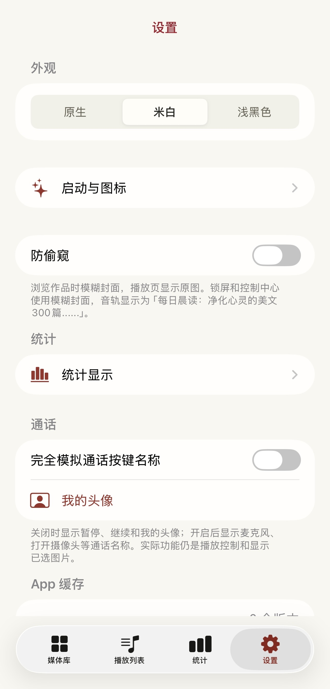
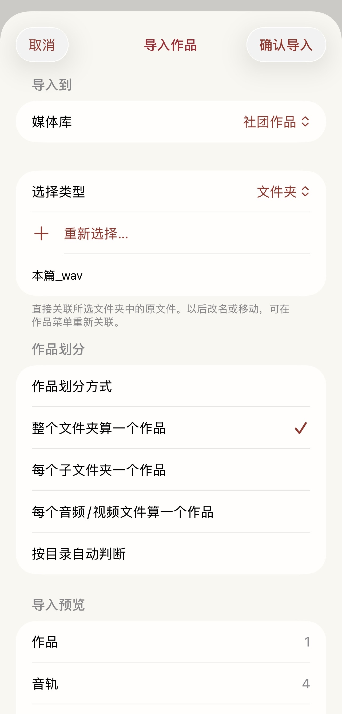
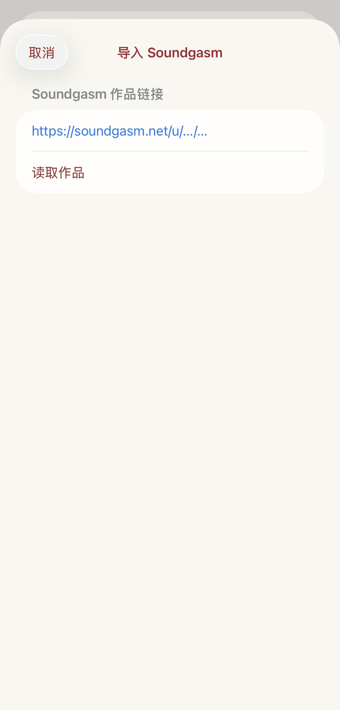
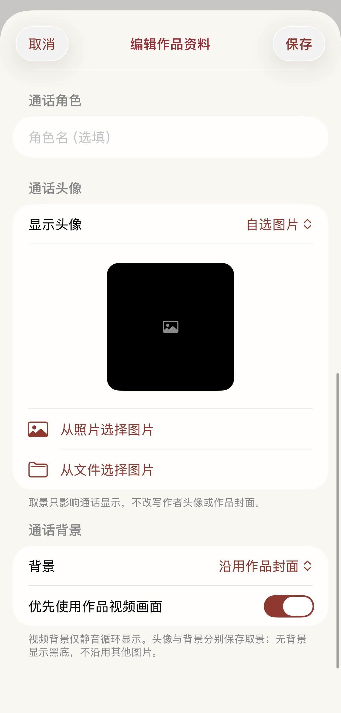
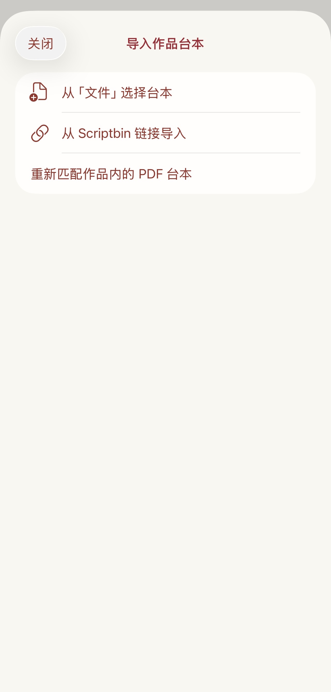

  

<h1 align="center">Sumo · 厮磨</h1>

<strong>A personal library for the voices you love.</strong>

Independently developed · All features free for personal, non-commercial use · Source available

  <a href="https://github.com/Reyanna0o0/Sumo-soundplayer/releases/download/v0.1.3/simo-0.1.3-build36-unsigned.ipa"><strong>Download IPA</strong></a> ·
  <a href="INSTALL.md"><strong>Installation guide</strong></a> ·
  <a href="https://github.com/Reyanna0o0/Sumo-soundplayer/releases"><strong>Releases</strong></a>

v0.1.3 · build 36 &nbsp; | &nbsp; iOS / iPadOS 18 or later

<a href="../../../README.md">简体中文</a> · <a href="../zh-Hant/README.md">繁體中文</a> · <strong>English</strong> · <a href="../ja/README.md">日本語</a> · <a href="../ko/README.md">한국어</a>

Sumo is an iOS audio player built around organizing your collection and immersive listening. Personal Audio and Indie Releases have separate libraries, bringing audio, video, covers, scripts and listening history together. No app account is required—import your own collection and start listening. The interface supports Simplified Chinese, Traditional Chinese, English, Japanese and Korean.

> **Build 36 has been rebuilt.** The download keeps the same filename and replaces the previous build 36 package, fixing standard text layouts, larger text support and report exports. Even if you already have build 36, download it again and install over the existing app with your original Apple Account and signing settings. **Do not uninstall first.** [Changes and verification — Simplified Chinese](../../RELEASE_BUILD36.md)

## From import to listening in three steps

| Import | Organize | Listen |
| --- | --- | --- |
| Choose audio, video, a folder or ZIP, or paste a single Soundgasm work link. | Group files into works and add covers, creators, scripts and categories. | Choose the regular player, call-style view or fullscreen subtitles. |

## Three ways to enjoy the same collection

<table>
  <tr>
    <th align="center">Regular player</th>
    <th align="center">Immersive call view</th>
    <th align="center">Fullscreen subtitles</th>
  </tr>
  <tr>
    <td align="center"></td>
    <td align="center"></td>
    <td align="center"></td>
  </tr>
  <tr>
    <td valign="top">Speed, pitch, equalizer, repeat, sleep timer and queue controls, plus background and Lock Screen playback.</td>
    <td valign="top">Set a character, avatar and background for each work, with voice-call or video-call styling.</td>
    <td valign="top">Read alongside the audio, arrange original text and translations, edit subtitles, set timings or open a floating subtitle window.</td>
  </tr>
</table>

These three examples were captured in the app running in a simulator, using fictional works and original demo content rather than existing audio releases. **Screenshots throughout this page show the Chinese interface; the app also supports English.** Picture-in-picture availability depends on the device; the call screenshot retains the simulator’s system notice. The call view plays local media and does not place real calls. Regular-player adjustments such as speed are unavailable in this view. [Playback details — Simplified Chinese](../../USAGE.md#播放与通话)

## Keep your collection organized and see your listening habits

<table>
  <tr>
    <th align="center">Import from different sources</th>
    <th align="center">Follow your listening history</th>
    <th align="center">Make it your own</th>
  </tr>
  <tr>
    <td align="center"></td>
    <td align="center"></td>
    <td align="center"></td>
  </tr>
  <tr>
    <td valign="top">Import audio, video, folders and ZIPs. Preview works and tracks before saving to Personal Audio or Indie Releases.</td>
    <td valign="top">See total time, works played, listening days, averages per listening day and streaks. View the libraries separately or together; durations retain seconds.</td>
    <td valign="top">Choose Native, Ivory, Soft Black or Purple, and adjust the app icon, launch audio, statistics and call-button labels.</td>
  </tr>
</table>

The settings screenshot shows the first three appearances; scroll horizontally to find Purple. Cover privacy blurs covers while browsing. On the Lock Screen and in Control Center it also substitutes the track title and omits work and creator details. The player still shows the original cover.

### One folder, several ways to organize it

Folder and ZIP imports offer four grouping options: **the whole folder, each subfolder, each audio/video file, or automatic grouping by directory**. Selecting individual audio or video files creates one work per file.

Individual media files are copied into the app; folder imports keep a reference to the external location. If that folder moves or is renamed, relink it from the work menu to preserve the existing details and subtitle versions. [Import and relinking — Simplified Chinese](../../USAGE.md#导入作品)

See grouping options and the import preview

### Bring a Soundgasm work into your library

Paste a **single Soundgasm work link**, read and confirm its details, then download an audio copy. Saved audio works offline; loading the page and downloading require internet access. [Supported links and instructions — Simplified Chinese](../../USAGE.md#从链接导入)

See the Soundgasm import screen

### Match the listening view to the work

Set the **call character, avatar, background and framing** independently. Inherit the cover, choose your own images or prefer video from the work. Avatar and background settings are saved separately without changing the original work cover. Background videos loop silently; still images can use an on-device depth effect.

See avatar and background settings

### Keep scripts with their works

Choose a local script, open a **Scriptbin** link and extract and review its text, or rematch PDFs already attached to a work. Timestamped subtitles such as SRT and LRC follow playback. Untimed scripts can be read as they are or timed manually, sentence by sentence; edits create a new version.

Import both the original and a translation to pair them and display them together. **Sumo does not automatically translate; you supply both texts.** [Scripts, subtitles and timing — Simplified Chinese](../../USAGE.md#字幕与台本)

See script import options

### Save a favorite moment—and your listening history

Add tracks to playlists, or use the scissors control to mark an excerpt and save it as an independent clip. Clips can retain subtitles, be combined and be exported as MP3 or WAV. Lists and categories support reordering and moving items.

Monthly reviews and annual reports collect your listening time, milestones and rankings into a continuous long image you can save or share.

[Playlists and clips — Simplified Chinese](../../USAGE.md#播放列表与摘选) · [Statistics and report sharing — Simplified Chinese](../../USAGE.md#统计外观与语言)

## Free for personal, non-commercial use, with source available

Every feature is free for personal, non-commercial use. You can choose to support development; donations do not unlock extra benefits, exclusive features or paid content, and do not grant commercial-use permission.

**[Support via Stripe](https://donate.stripe.com/7sYcN4ctY5GM3rK3oM7ok00) · [Support via Afdian](https://afdian.com/a/Reyanna0o0)**

The project uses the custom **Sumo Sound Player Noncommercial Source License 1.0**, not MIT, GPL or an OSI-approved open-source license. Non-commercial use, modification and free sharing are permitted under its terms. Keep the license, credits and project link when sharing; modified versions must also include complete corresponding source and be marked unofficial. **All commercial use requires prior written permission from Reyanna0o0.** [License — the Chinese text is authoritative](../../../LICENSE) · [Commercial use — Simplified Chinese](../../COMMERCIAL_USE.md)

## Installation and updates

Sumo is currently installed through self-signing, rather than the App Store.

1. [Download the IPA](https://github.com/Reyanna0o0/Sumo-soundplayer/releases/download/v0.1.3/simo-0.1.3-build36-unsigned.ipa) on a computer, and prepare a signing tool such as Sideloadly and your own Apple Account.
2. Connect your iPhone or iPad with a cable and follow the [installation guide](INSTALL.md).
3. If prompted, trust your developer account under **Settings → General → VPN & Device Management** and enable Developer Mode as described in the guide.

For updates or signing renewal, use the same Apple Account, app identifier and signing settings to install over the existing app. **Keep the app; do not uninstall it first.** The guide covers signing expiry, renewal and alternative installation methods.

[Download help](DOWNLOAD.md) · [Installation, renewal and updates](INSTALL.md) · [Corresponding source ZIP](https://github.com/Reyanna0o0/Sumo-soundplayer/releases/download/v0.1.3/simo-0.1.3-build36-source.zip) · [Verified scope — Simplified Chinese](../../RELEASE_STATUS.md)

## Your data and your content

Library data, subtitle versions, playlists, clips and listening history stay on your device. There is no project-operated cloud library or cross-device sync. Link imports access the relevant websites; iCloud Drive, system backups and cloud exports follow your OS and service-provider settings.

Keep separate copies of important original files. The app does not include audio works or scripts, and demo screenshots do not indicate bundled content. Import media you have the right to use, and consider the work information included when sharing clips, subtitles or reports. [File retention and caches — Simplified Chinese](../../USAGE.md#缓存与数据保留)

## Feedback and future plans

Report bugs or suggest improvements through [GitHub Issues](https://github.com/Reyanna0o0/Sumo-soundplayer/issues). Include your device OS, app version and reproduction steps, and hide private work titles and account information in screenshots. [Report a bug](https://github.com/Reyanna0o0/Sumo-soundplayer/issues/new?template=bug-report.yml)

The available app runs on iOS and iPadOS. Updates and plans for Android will be recorded on GitHub; **there is no Android release schedule yet**. Star the project to bookmark it, or subscribe to releases under **Watch → Custom → Releases** for update notifications.

To contribute, read the [build guide](../../BUILD.md), [validation record](../../RELEASE_STATUS.md) and [fix history](../../AI_REVIEW_FIXES.md), then discuss your proposed change in Issues. These detailed documents and issue templates are currently in Simplified Chinese.

Project structure and visual credits

| Directory | Contents |
| --- | --- |
| `SituationVoicePlayer/` | SwiftUI app, resources and Xcode project |
| `hibiki/` | HibikiCore, database, subtitle logic and self-checks |
| `ThirdParty/` | Third-party source, model provenance and licenses |
| `scripts/` | Resource checks, builds, tests and IPA packaging |
| `tools/localization/` | The existing five-language catalog and generation tools |

The icon and launch-screen concept is by Reyanna0o0. A friend contributed authorized hand-drawn revisions; base imagery and animation were created with assistance from ChatGPT. Showcase images and demo content have separate provenance records; existing audio releases are not used as demonstration content.

Third-party components retain their own licenses, including applicable LGPL rights to modify, debug, replace and relink them. Distributions containing LGPL components must include the corresponding source and rebuild materials.

[Visual assets — Simplified Chinese](../../ASSETS.md) · [Third-party materials — Simplified Chinese](../../THIRD_PARTY.md) · [Request commercial permission](https://github.com/Reyanna0o0/Sumo-soundplayer/issues/new?template=commercial-license.yml) · [Developer email](mailto:sumo-soundplayer@outlook.com)

---

<strong>Keep the voices you love in Sumo.</strong>

<a href="https://github.com/Reyanna0o0/Sumo-soundplayer/releases/download/v0.1.3/simo-0.1.3-build36-unsigned.ipa">Download IPA</a> · <a href="INSTALL.md">Installation guide</a> · <a href="https://github.com/Reyanna0o0/Sumo-soundplayer">Star on GitHub</a>

