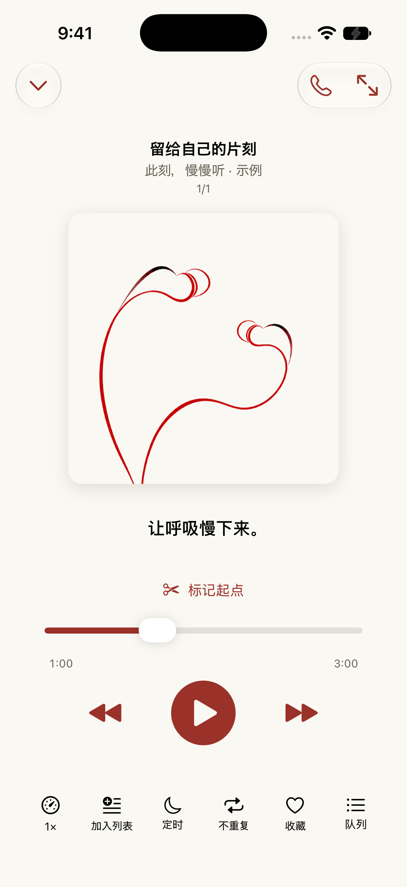
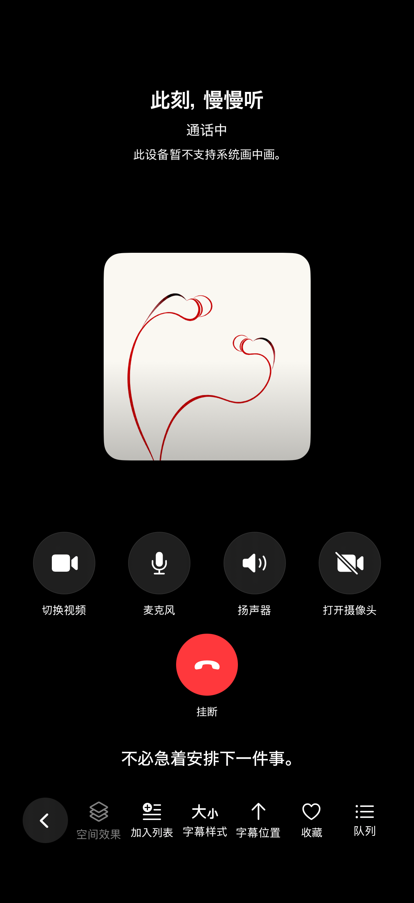
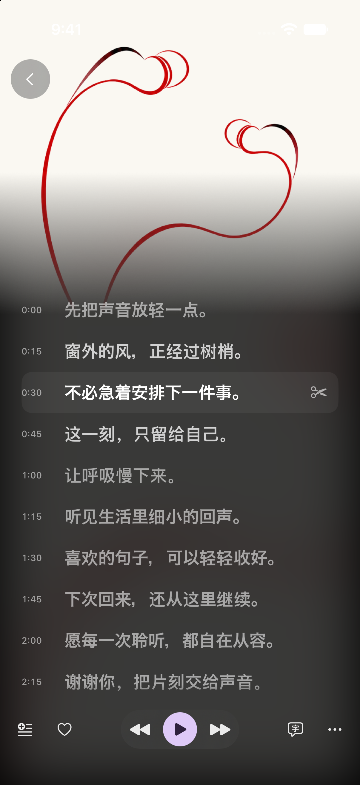
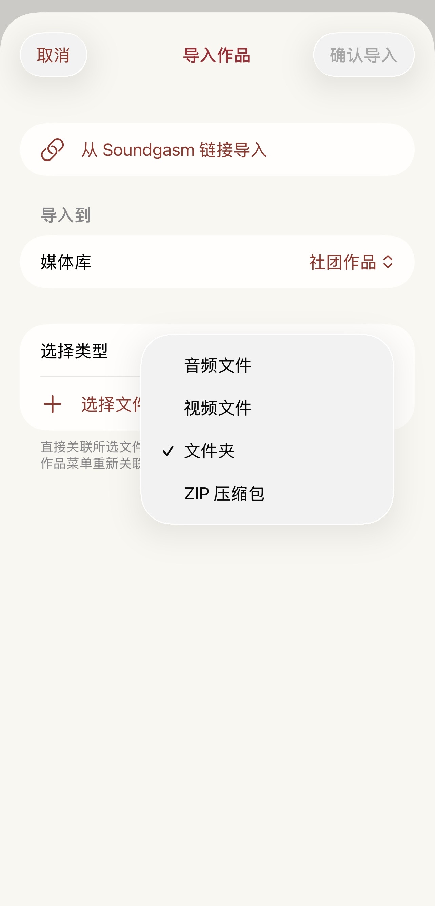
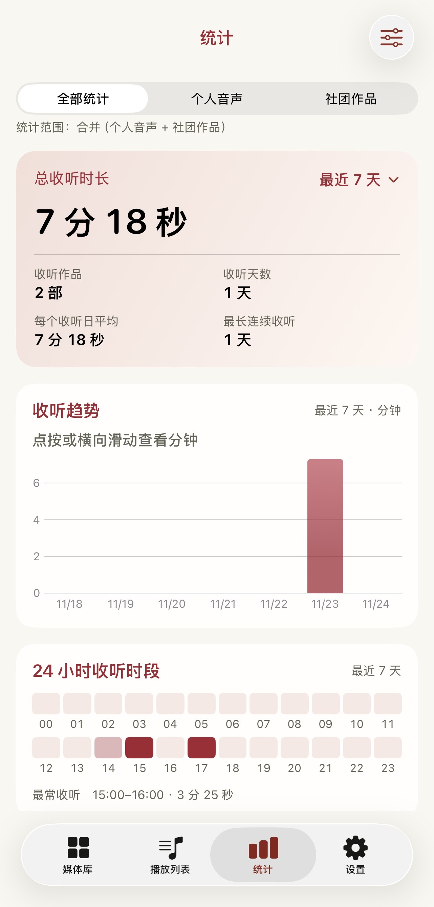
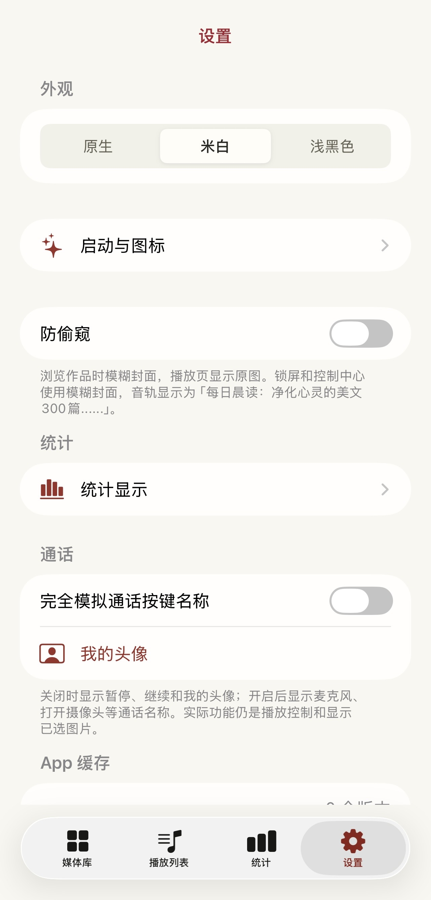
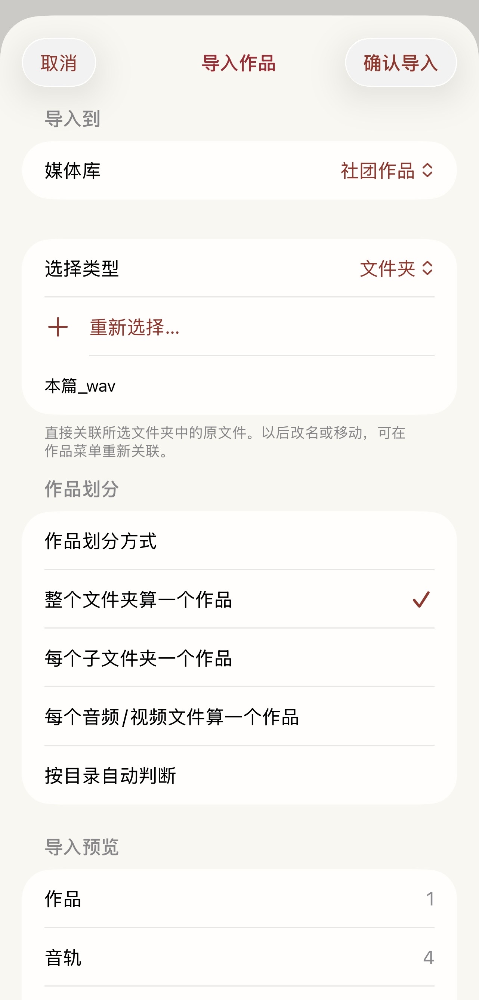
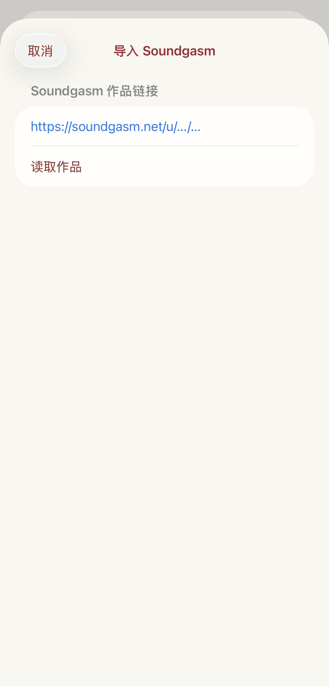
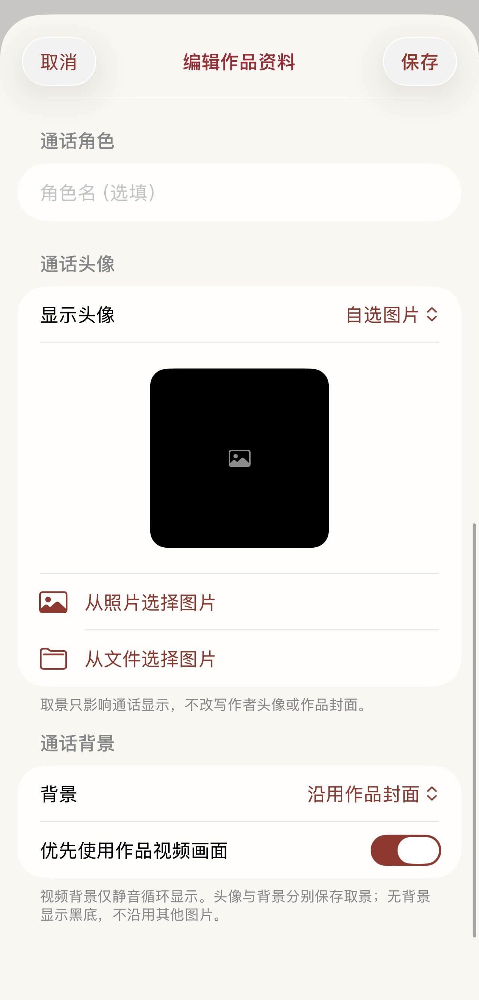
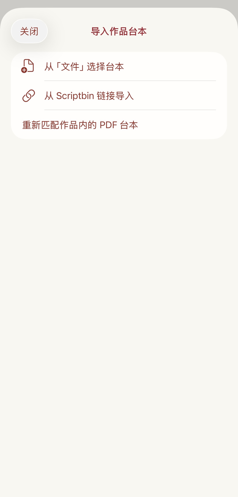

  

<h1 align="center">厮磨 · Simo</h1>

<strong>好きな声を、自分だけのライブラリに。</strong>

個人開発 · 個人の非商用利用は全機能無料 · ソース公開

  <a href="https://github.com/Reyanna0o0/Simo-soundplayer/releases/download/v0.1.4/simo-0.1.4-build37-unsigned.ipa"><strong>IPA をダウンロード</strong></a> ·
  <a href="INSTALL.md"><strong>インストール方法</strong></a> ·
  <a href="https://github.com/Reyanna0o0/Simo-soundplayer/releases"><strong>リリース情報</strong></a>

v0.1.4 · build 37 &nbsp; | &nbsp; iOS / iPadOS 18 以降

<a href="../../../README.md">简体中文</a> · <a href="../zh-Hant/README.md">繁體中文</a> · <a href="../en/README.md">English</a> · <strong>日本語</strong> · <a href="../ko/README.md">한국어</a>

厮磨は、作品の整理と没入感のある再生を大切にした iOS 向け音声プレイヤーです。個人の音声作品とサークル作品を別々のライブラリで管理し、音声・動画・カバー・台本・再生履歴をひとつにまとめます。アカウント登録は不要。自分のコレクションを取り込んですぐに聴けます。簡体字中国語、繁体字中国語、英語、日本語、韓国語に対応しています。

> **v0.1.4 · build 37：スピーカー再生の保護と、バックグラウンド再開条件の見直し。** 本体スピーカーは初期状態で消音され、再生中のシステム音量調節やヘッドフォンへの出力切り替えで解除できます。バックグラウンドで他の音声に中断された後は、手動で再開するまで一時停止します。同じ Apple Account と署名設定で上書きし、**先にアプリを削除しないでください。** [更新内容（簡体字中国語）](../../RELEASE_BUILD37.md)

## 取り込みから再生まで、3 ステップ

| 取り込む | 整理する | 聴く |
| --- | --- | --- |
| 音声・動画・フォルダ・ZIP を選ぶか、Soundgasm の作品リンクを貼り付けます。 | ファイルやフォルダを作品単位にまとめ、カバー・クリエイター・台本・カテゴリを設定します。 | 通常再生、通話風の画面、全画面字幕から、好みの聴き方を選べます。 |

## 同じ作品を、3 つの聴き方で

<table>
  <tr>
    <th align="center">通常のプレイヤー</th>
    <th align="center">没入感のある通話画面</th>
    <th align="center">全画面字幕</th>
  </tr>
  <tr>
    <td align="center"></td>
    <td align="center"></td>
    <td align="center"></td>
  </tr>
  <tr>
    <td valign="top">速度・音程・イコライザー・リピート・スリープタイマー・キューを調整。バックグラウンドやロック画面からも操作できます。</td>
    <td valign="top">作品ごとにキャラクター・アバター・背景を設定し、音声通話風とビデオ通話風の画面を切り替えられます。</td>
    <td valign="top">聴きながら読み、原文と訳文の表示を調整。字幕の編集、手動のタイミング設定、字幕のフローティング表示にも対応します。</td>
  </tr>
</table>

上の 3 枚は、シミュレータ上で動作するアプリを実際に撮影したものです。架空の作品とオリジナルのデモ内容を使用し、実在する音声作品は使っていません。**このページのスクリーンショットは中国語表示ですが、アプリは日本語にも対応しています。** ピクチャ・イン・ピクチャの利用可否は端末によって異なり、通話の画像にはシミュレータのシステムメッセージをそのまま残しています。通話画面はローカルメディアの再生用で、実際の通話は発信しません。この画面では倍速などの通常プレイヤーの調整はできません。[再生と通話画面の説明（簡体字中国語）](../../USAGE.md#播放与通话)

## コレクションを整えて、聴いた時間を振り返る

<table>
  <tr>
    <th align="center">さまざまな形式から取り込み</th>
    <th align="center">自分の再生記録を確認</th>
    <th align="center">使い方に合わせて設定</th>
  </tr>
  <tr>
    <td align="center"></td>
    <td align="center"></td>
    <td align="center"></td>
  </tr>
  <tr>
    <td valign="top">音声・動画・フォルダ・ZIP に対応。作品とトラックを確認してから、個人の音声作品またはサークル作品のライブラリへ保存します。</td>
    <td valign="top">合計時間、作品数、聴いた日数、聴いた日あたりの平均、連続記録を表示。2 つのライブラリを別々にも合算でも集計でき、秒数も残ります。</td>
    <td valign="top">標準・アイボリー・ソフトブラック・パープルの 4 種類。アプリアイコン、起動音、統計の表示、通話ボタンの名称も変更できます。</td>
  </tr>
</table>

設定画像には最初の 3 つの外観が写っています。パープルは横にスクロールすると選べます。カバーのプライバシー機能を有効にすると、閲覧時のカバーをぼかします。ロック画面とコントロールセンターではカバーをぼかし、トラック名を別の表示に置き換え、作品名・クリエイター情報を表示しません。プレイヤー内では元のカバーを表示します。

### スピーカーで鳴らす前に、ひとつ確認

**スピーカー再生の保護は初期設定でオン**です。「設定」でオフにできます。本体スピーカーでは、音声・動画・通話モード・起動時の音声が消音状態で始まります。再生中にシステム音量を調節するか、**「今回のスピーカー再生を許可」**を押すか、出力をヘッドフォンに切り替えると解除できます。一時停止後の再開時やスピーカー出力に戻ったときは、再び保護されます。Simo の音だけを消音し、システム音量は変更しません。消音を解除しても一時停止中の内容は自動再生されません。音量が最大・最小でキーを押しても変わらない場合は、許可ボタンを使えます。

アプリがバックグラウンドまたは非アクティブの間に中断が終了した場合は、一時停止を維持します。前面では、中断前に同じ項目を再生しており、手動で一時停止されず、システムが許可した場合に限り自動再開します。[使い方](../../USAGE.md#speaker-protection-translations)

### ひとつのフォルダを、好みの作品単位に

フォルダと ZIP の取り込みでは、**フォルダ全体・サブフォルダごと・音声／動画ファイルごと・ディレクトリから自動判定**の 4 通りを選べます。音声や動画を個別に選ぶ場合は、1 ファイルにつき 1 作品を作成します。

個別のメディアファイルはアプリ内にコピーします。フォルダは外部の元の場所を参照するため、名前や場所を変えた場合は作品メニューから再関連付けできます。既存の作品情報や字幕バージョンは維持されます。[取り込みと再関連付け（簡体字中国語）](../../USAGE.md#导入作品)

作品の分け方と取り込みプレビューを見る

### Soundgasm の音声もライブラリへ

**Soundgasm の単一作品リンク**を貼り付け、情報を読み込んで確認してから音声のコピーをダウンロードします。保存後はオフラインで再生できます。ページの読み込みとダウンロードには通信が必要です。[リンクの対応範囲と手順（簡体字中国語）](../../USAGE.md#从链接导入)

Soundgasm の取り込み画面を見る

### 作品の雰囲気に合う再生画面に

**通話のキャラクター・アバター・背景・表示範囲**をそれぞれ設定できます。カバーを引き継ぐ、自分の画像を選ぶ、作品内の動画を優先する、といった使い方ができます。アバターと背景は別々に保存し、元の作品カバーは変更しません。動画背景は無音でループ再生し、静止画には端末内で処理する奥行き効果を適用できます。

アバターと背景の設定を見る

### 台本も作品と一緒に

「ファイル」から台本を選ぶ、**Scriptbin** のページを開いて本文を抽出・確認する、作品内の PDF 台本とトラックを再照合する、といった取り込み方に対応します。SRT・LRC など時間情報付きの字幕は再生に追従します。時間情報のない台本はそのまま読むことも、文ごとに手動で時間を付けることもでき、編集は新しいバージョンとして保存されます。

原文と訳文を両方取り込むと、対応付けて上下に表示できます。**自動翻訳機能はありません。原文と訳文は利用者が用意します。** [台本・字幕・タイミング調整（簡体字中国語）](../../USAGE.md#字幕与台本)

台本の取り込みメニューを見る

### 好きな一節も、聴いた足跡も残す

続けて聴くトラックをプレイリストへ。好きな部分は、はさみボタンで開始点と終了点を指定し、独立したクリップとして保存できます。字幕の保持、クリップの結合、MP3・WAV への書き出しに対応し、リストやカテゴリ内の並べ替え・移動もできます。

月間レビューと年間レポートでは、再生時間、聴いた記録、ランキングを振り返れます。ひと続きの縦長画像として書き出して保存・共有することもできます。

[プレイリストとクリップ（簡体字中国語）](../../USAGE.md#播放列表与摘选) · [統計とレポート共有（簡体字中国語）](../../USAGE.md#统计外观与语言)

## 個人の非商用利用は全機能無料、ソースも公開

すべての機能を個人の非商用利用で無料で使えます。開発への支援は任意です。支援によって追加の特典、限定機能、有料コンテンツが解放されることはなく、商用利用の許可が付与されるわけでもありません。

**[Stripe で支援する](https://donate.stripe.com/7sYcN4ctY5GM3rK3oM7ok00) · [愛発電で支援する](https://afdian.com/a/Reyanna0o0)**

本プロジェクトは独自の **Simo Sound Player 非商用ソースライセンス 1.0** を採用しています。MIT、GPL、OSI 承認のオープンソースライセンスではありません。規約に従って非商用での利用・改変・無償共有が可能です。共有時はライセンス・クレジット・プロジェクトへのリンクを残し、改変版には完全な対応ソースを付けて非公式版と明示してください。**すべての商用利用には、事前に Reyanna0o0 の書面による許可が必要です。** [ライセンス原文（中国語が正式な本文）](../../../LICENSE) · [商用利用の説明（簡体字中国語）](../../COMMERCIAL_USE.md)

## インストールと更新

現在は App Store ではなく、自分のアカウントで署名してインストールする方式です。

1. コンピュータで [IPA をダウンロード](https://github.com/Reyanna0o0/Simo-soundplayer/releases/download/v0.1.4/simo-0.1.4-build37-unsigned.ipa)し、Sideloadly などの署名ツールと自分の Apple Account を用意します。
2. iPhone / iPad をケーブルで接続し、[インストール手順](INSTALL.md)に沿って署名・インストールします。
3. 必要な場合は「設定 → 一般 → VPN とデバイス管理」で開発者アカウントを信頼し、手順に従ってデベロッパモードを有効にします。

更新や署名の更新では、同じ Apple Account・アプリ識別子・署名設定で上書きします。**元のアプリを残し、先に削除しないでください。** 署名の有効期間や更新、ほかのインストール方法については詳細な手順をご覧ください。

[ダウンロード案内](DOWNLOAD.md) · [インストール・署名更新・アップデート](INSTALL.md) · [対応するソース ZIP](https://github.com/Reyanna0o0/Simo-soundplayer/releases/download/v0.1.4/simo-0.1.4-build37-source.zip) · [検証済みの範囲（簡体字中国語）](../../RELEASE_STATUS.md)

## データとコンテンツは自分の手元に

ライブラリ、字幕バージョン、プレイリスト、クリップ、再生履歴は端末内に保存されます。プロジェクトが運営するクラウドライブラリや端末間同期はありません。リンクの取り込みは該当サイトに接続し、iCloud Drive、システムのバックアップ、クラウドへの書き出しは OS とサービス提供元の設定に従います。

大切な元ファイルは別途保管してください。アプリに音声作品や台本は付属せず、デモ画像も収録内容を示すものではありません。利用する権利のあるメディアを取り込み、クリップ・字幕・レポートの共有時には含まれる作品情報にも配慮してください。[ファイルの保持とキャッシュ（簡体字中国語）](../../USAGE.md#缓存与数据保留)

## フィードバックと今後の予定

不具合や機能・画面への提案は [GitHub Issues](https://github.com/Reyanna0o0/Simo-soundplayer/issues) へ。端末の OS、アプリのバージョン、再現手順を添え、画像に含まれる私的な作品名やアカウント情報は伏せてください。[不具合を報告](https://github.com/Reyanna0o0/Simo-soundplayer/issues/new?template=bug-report.yml)

現在は iOS / iPadOS 版を提供しています。今後の更新と Android 対応の計画は GitHub で記録しますが、**Android 版の公開時期は未定です**。**Star** でプロジェクトを保存でき、更新通知が必要な場合は **Watch → Custom → Releases** からリリースを購読できます。

開発への参加を考えている方は、[ビルド手順](../../BUILD.md)、[検証記録](../../RELEASE_STATUS.md)、[これまでの修正内容](../../AI_REVIEW_FIXES.md)を確認し、Issues で相談してから変更を提案してください。詳細文書と報告テンプレートは現在、簡体字中国語です。

開発ディレクトリと素材のクレジット

| ディレクトリ | 内容 |
| --- | --- |
| `SituationVoicePlayer/` | SwiftUI アプリ、リソース、Xcode プロジェクト |
| `hibiki/` | HibikiCore、データベース、字幕処理、セルフチェック |
| `ThirdParty/` | サードパーティのソース、モデルの出典、ライセンス |
| `scripts/` | リソース検証、ビルド、テスト、IPA 作成 |
| `tools/localization/` | 既存の 5 言語翻訳と生成ツール |

アイコンと起動画面の構想は Reyanna0o0 によるもので、友人が許諾済みの手描き修正を担当しました。ベース画像とアニメーションの制作には ChatGPT の支援を使用しています。紹介画像とデモ内容の出典は別途記録しており、実在する音声作品をデモには使っていません。

サードパーティの構成要素にはそれぞれのライセンスが適用され、対象となる LGPL の改変・デバッグ・置き換え・再リンクの権利は維持されます。LGPL の構成要素を含む配布物には、対応するソースと再ビルド用の資料も提供してください。

[素材の説明（簡体字中国語）](../../ASSETS.md) · [サードパーティ資料（簡体字中国語）](../../THIRD_PARTY.md) · [商用利用の申請](https://github.com/Reyanna0o0/Simo-soundplayer/issues/new?template=commercial-license.yml) · [開発者へのメール](mailto:sumo-soundplayer@outlook.com)

---

<strong>好きな声を、厮磨に。</strong>

<a href="https://github.com/Reyanna0o0/Simo-soundplayer/releases/download/v0.1.4/simo-0.1.4-build37-unsigned.ipa">IPA をダウンロード</a> · <a href="INSTALL.md">インストール手順</a> · <a href="https://github.com/Reyanna0o0/Simo-soundplayer">GitHub で Star</a>

