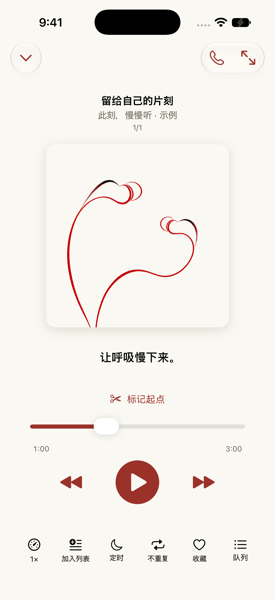
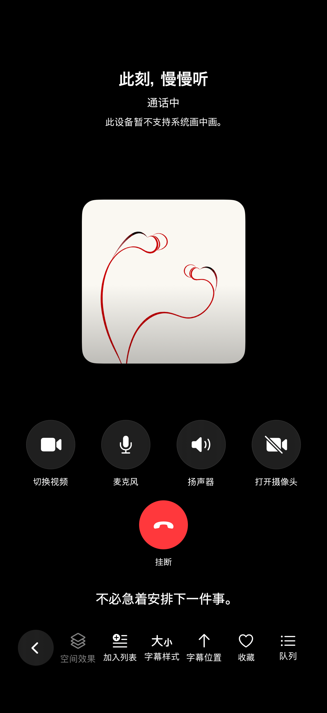
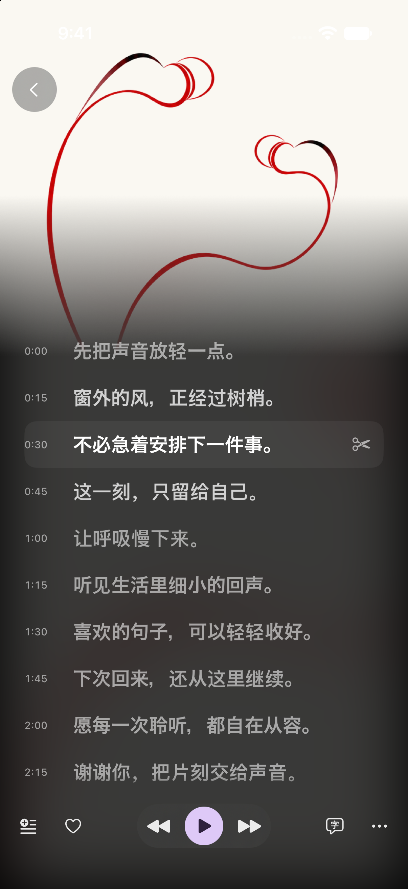
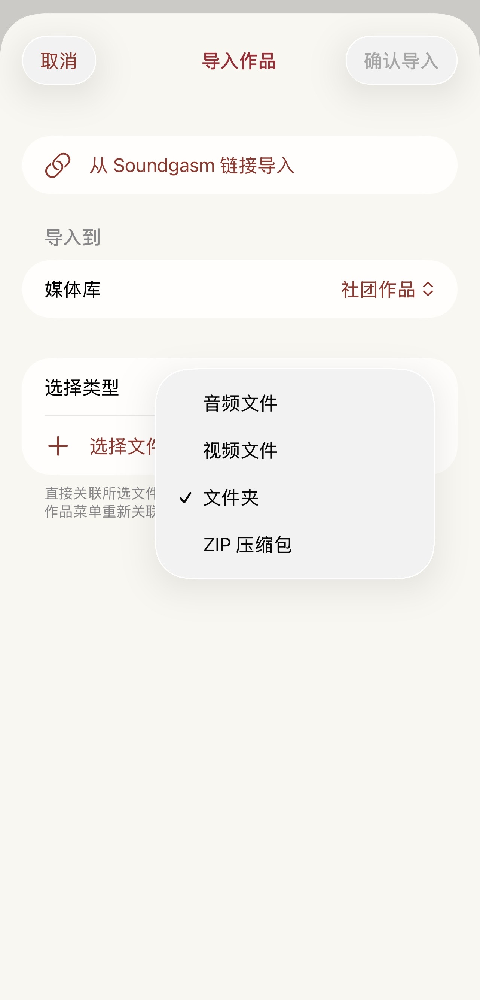
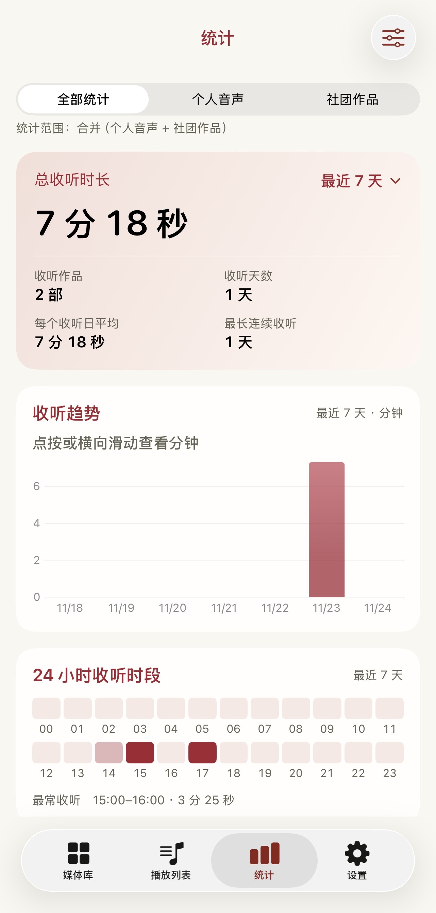
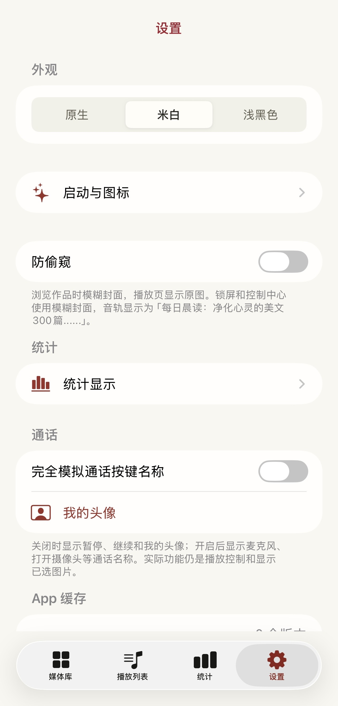
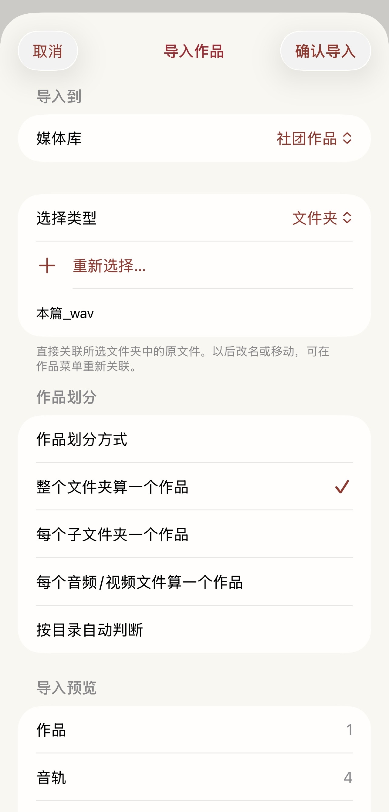
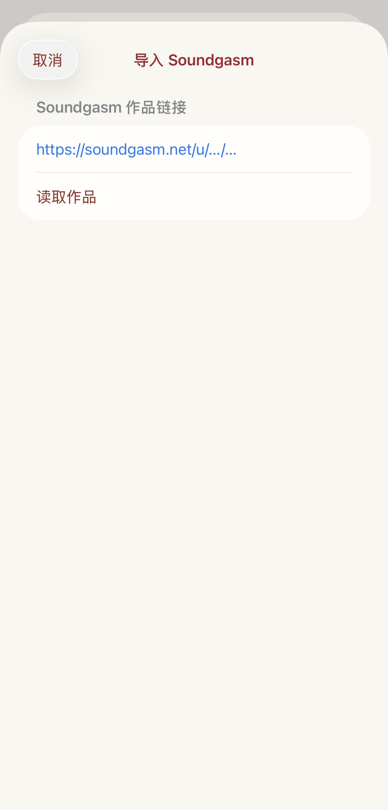
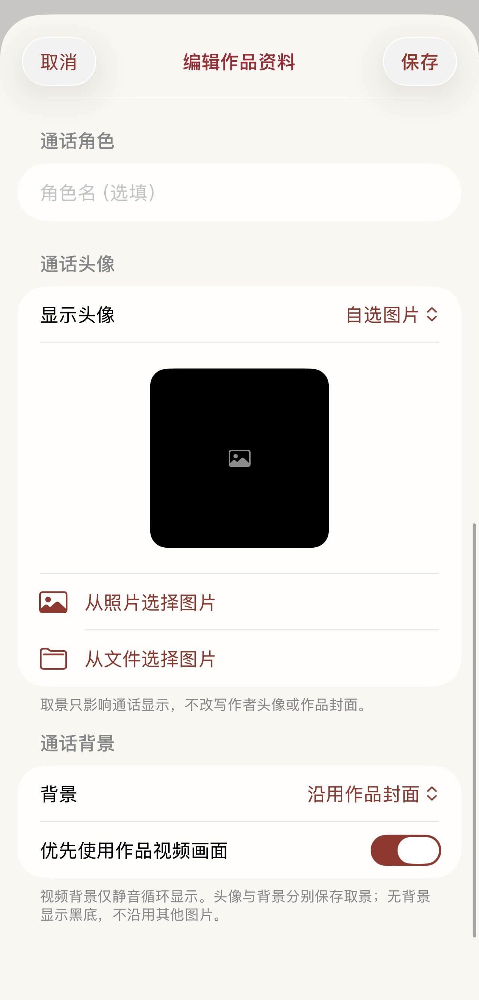
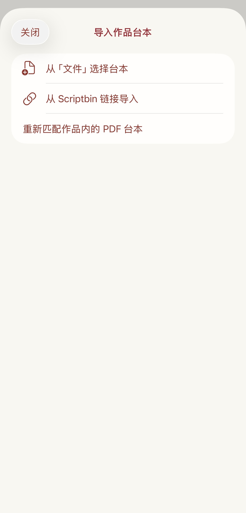

  

<h1 align="center">Sumo · 厮磨</h1>

<strong>좋아하는 목소리를, 나만의 라이브러리로.</strong>

개인 개발 · 개인의 비상업적 이용은 모든 기능 무료 · 소스 공개

  <a href="https://github.com/Reyanna0o0/Sumo-soundplayer/releases/download/v0.1.3/simo-0.1.3-build36-unsigned.ipa"><strong>IPA 다운로드</strong></a> ·
  <a href="INSTALL.md"><strong>설치 방법</strong></a> ·
  <a href="https://github.com/Reyanna0o0/Sumo-soundplayer/releases"><strong>릴리스 소식</strong></a>

v0.1.3 · build 36 &nbsp; | &nbsp; iOS / iPadOS 18 이상

<a href="../../../README.md">简体中文</a> · <a href="../zh-Hant/README.md">繁體中文</a> · <a href="../en/README.md">English</a> · <a href="../ja/README.md">日本語</a> · <strong>한국어</strong>

Sumo는 작품 정리와 몰입감 있는 재생을 중심으로 만든 iOS 오디오 플레이어입니다. 개인 오디오 작품과 서클 작품을 별도 라이브러리로 관리하면서 오디오, 동영상, 표지, 대본과 청취 기록을 한곳에 모읍니다. 앱 계정을 만들 필요 없이, 자신의 컬렉션을 가져와 바로 들을 수 있습니다. 중국어 간체·번체, 영어, 일본어, 한국어를 지원합니다.

> **build 36을 다시 빌드했습니다.** 같은 파일명의 설치 패키지를 교체하여 일반 글자 크기의 배치, 큰 글자 지원, 보고서 긴 이미지 내보내기를 수정했습니다. 기존 build 36을 사용 중이어도 다시 다운로드한 뒤 원래 Apple 계정과 서명 설정으로 덮어써 주세요. **기존 앱을 먼저 삭제하지 마세요.** [변경 내용과 확인 방법 — 중국어 간체](../../RELEASE_BUILD36.md)

## 가져오기부터 재생까지, 세 단계

| 가져오기 | 정리하기 | 듣기 |
| --- | --- | --- |
| 오디오, 동영상, 폴더, ZIP을 선택하거나 Soundgasm 개별 작품 링크를 붙여 넣습니다. | 파일과 폴더를 작품 단위로 묶고 표지, 창작자, 대본과 분류를 설정합니다. | 일반 플레이어, 통화 화면, 전체 화면 자막 중 편한 방식을 선택합니다. |

## 같은 작품을 즐기는 세 가지 방법

<table>
  <tr>
    <th align="center">일반 플레이어</th>
    <th align="center">몰입형 통화 화면</th>
    <th align="center">전체 화면 자막</th>
  </tr>
  <tr>
    <td align="center"></td>
    <td align="center"></td>
    <td align="center"></td>
  </tr>
  <tr>
    <td valign="top">속도, 음정, 이퀄라이저, 반복, 수면 타이머와 대기열을 조절하고 백그라운드나 잠금 화면에서도 재생을 제어합니다.</td>
    <td valign="top">작품별 캐릭터, 아바타와 배경을 설정하고 음성 통화형 또는 영상 통화형 화면으로 전환합니다.</td>
    <td valign="top">들으면서 읽고 원문·번역문 표시를 조절합니다. 자막 편집, 수동 타이밍 지정과 자막 플로팅 창도 사용할 수 있습니다.</td>
  </tr>
</table>

위 세 장은 시뮬레이터에서 실행한 앱을 직접 촬영한 화면입니다. 가상 작품과 직접 만든 시연용 콘텐츠를 사용했으며 실제 오디오 작품은 사용하지 않았습니다. **이 페이지의 스크린샷은 중국어 화면이며, 앱은 한국어도 지원합니다.** 화면 속 화면(PiP) 지원 여부는 기기에 따라 다르며, 통화 스크린샷에는 시뮬레이터의 시스템 안내를 그대로 남겼습니다. 통화 화면은 로컬 미디어 재생용으로 실제 전화를 걸지 않습니다. 이 화면에서는 속도 조절 등 일반 플레이어의 설정을 사용할 수 없습니다. [재생과 통화 화면 안내 — 중국어 간체](../../USAGE.md#播放与通话)

## 컬렉션을 정리하고, 청취 습관을 돌아보세요

<table>
  <tr>
    <th align="center">다양한 형식으로 가져오기</th>
    <th align="center">나의 청취 기록 확인하기</th>
    <th align="center">내 방식대로 설정하기</th>
  </tr>
  <tr>
    <td align="center"></td>
    <td align="center"></td>
    <td align="center"></td>
  </tr>
  <tr>
    <td valign="top">오디오, 동영상, 폴더와 ZIP을 지원합니다. 작품과 트랙을 미리 확인한 뒤 개인 오디오 또는 서클 작품 라이브러리에 저장합니다.</td>
    <td valign="top">총 시간, 작품 수, 청취 일수, 청취한 날의 일평균과 연속 기록을 확인합니다. 두 라이브러리를 따로 또는 합산해서 볼 수 있으며 초 단위도 유지합니다.</td>
    <td valign="top">기본, 아이보리, 소프트 블랙, 보라색의 네 가지 외관과 앱 아이콘, 시작 음성, 통계 표시, 통화 버튼 이름을 설정합니다.</td>
  </tr>
</table>

설정 스크린샷에는 앞의 세 외관이 보입니다. 옆으로 스크롤하면 보라색을 선택할 수 있습니다. 표지 보호 기능은 탐색 중 표지를 흐리게 표시합니다. 잠금 화면과 제어 센터에서는 표지를 흐리게 하고 트랙 제목을 대체 문구로 표시하며 작품·창작자 정보를 숨깁니다. 플레이어 안에서는 원본 표지를 보여 줍니다.

### 폴더 하나도 원하는 작품 단위로

폴더와 ZIP을 가져올 때는 **폴더 전체, 하위 폴더별, 오디오·동영상 파일별, 디렉터리에 따른 자동 판단**의 네 방식을 선택할 수 있습니다. 오디오나 동영상 파일을 개별 선택하면 파일마다 작품 하나를 만듭니다.

개별 미디어 파일은 앱 안으로 복사하고, 폴더는 외부 원래 위치와의 연결을 유지합니다. 외부 폴더의 이름이나 위치를 바꿨다면 작품 메뉴에서 새 위치에 다시 연결하여 기존 작품 정보와 자막 버전을 유지할 수 있습니다. [가져오기와 다시 연결 — 중국어 간체](../../USAGE.md#导入作品)

작품 나누기와 가져오기 미리 보기

### Soundgasm의 오디오도 라이브러리로

**Soundgasm 개별 작품 링크**를 붙여 넣고 정보를 읽어 확인한 뒤 오디오 사본을 다운로드합니다. 저장한 오디오는 오프라인으로 들을 수 있으며, 웹페이지를 읽거나 다운로드할 때는 인터넷 연결이 필요합니다. [지원 링크와 가져오기 안내 — 중국어 간체](../../USAGE.md#从链接导入)

Soundgasm 가져오기 화면 보기

### 작품 분위기에 어울리는 재생 화면

**통화 캐릭터, 아바타, 배경과 표시 범위**를 각각 설정할 수 있습니다. 작품 표지를 그대로 쓰거나 직접 이미지를 선택하고, 작품에 포함된 동영상을 우선 사용할 수도 있습니다. 아바타와 배경은 별도로 저장되며 원래 작품 표지를 바꾸지 않습니다. 동영상 배경은 소리 없이 반복 재생되고, 정지 이미지에는 기기에서 처리하는 깊이 효과를 적용할 수 있습니다.

아바타와 배경 설정 보기

### 대본도 작품과 함께

파일 앱에서 대본을 선택하거나 **Scriptbin** 페이지를 열어 본문을 추출·확인하고, 작품에 포함된 PDF 대본을 트랙에 다시 맞출 수 있습니다. SRT, LRC처럼 시간 정보가 있는 자막은 재생을 따라갑니다. 시간 정보가 없는 대본은 그대로 읽거나 문장별로 직접 시간을 지정할 수 있으며, 편집 내용은 새 버전으로 저장됩니다.

원문과 번역문을 모두 가져오면 짝을 맞춰 위아래로 표시할 수 있습니다. **Sumo에는 자동 번역 기능이 없습니다. 원문과 번역문은 사용자가 준비합니다.** [대본·자막·타이밍 안내 — 중국어 간체](../../USAGE.md#字幕与台本)

대본 가져오기 메뉴 보기

### 좋아하는 순간과 청취의 발자취를 남기세요

이어서 들을 트랙은 재생목록에 넣고, 마음에 드는 부분은 가위 버튼으로 시작점과 끝점을 지정해 독립된 클립으로 저장합니다. 자막 유지, 클립 결합, MP3·WAV 내보내기를 지원하며 목록과 분류에서 항목을 정렬하거나 옮길 수 있습니다.

월간 돌아보기와 연간 보고서에서는 청취 시간, 발자취와 순위를 확인할 수 있습니다. 하나로 이어지는 긴 이미지로 내보내 나만의 청취 기록을 저장하거나 공유하세요.

[재생목록과 클립 — 중국어 간체](../../USAGE.md#播放列表与摘选) · [통계와 보고서 공유 — 중국어 간체](../../USAGE.md#统计外观与语言)

## 개인의 비상업적 이용은 모든 기능 무료, 소스 공개

모든 기능을 개인의 비상업적 용도로 무료로 사용할 수 있습니다. 개발 후원은 자율입니다. 후원으로 추가 혜택, 전용 기능이나 유료 콘텐츠가 열리지 않으며, 상업적 이용 허가가 주어지는 것도 아닙니다.

**[Stripe로 후원하기](https://donate.stripe.com/7sYcN4ctY5GM3rK3oM7ok00) · [Afdian으로 후원하기](https://afdian.com/a/Reyanna0o0)**

프로젝트에는 자체 **Sumo Sound Player 비상업적 소스 라이선스 1.0**이 적용됩니다. MIT, GPL 또는 OSI 승인 오픈소스 라이선스가 아닙니다. 약관에 따라 비상업적 이용·수정·무료 공유가 가능합니다. 공유할 때는 라이선스, 저작자 표시와 프로젝트 링크를 유지해야 하며, 수정본에는 완전한 대응 소스를 제공하고 비공식 버전임을 표시해야 합니다. **모든 상업적 이용에는 Reyanna0o0의 사전 서면 동의가 필요합니다.** [라이선스 원문 — 중국어 원문이 유효](../../../LICENSE) · [상업적 이용 안내 — 중국어 간체](../../COMMERCIAL_USE.md)

## 설치와 업데이트

현재 App Store가 아닌 자신의 계정으로 서명하여 설치하는 방식입니다.

1. 컴퓨터에서 [IPA를 다운로드](https://github.com/Reyanna0o0/Sumo-soundplayer/releases/download/v0.1.3/simo-0.1.3-build36-unsigned.ipa)하고, Sideloadly 같은 서명 도구와 자신의 Apple 계정을 준비합니다.
2. iPhone 또는 iPad를 케이블로 연결하고 [설치 안내](INSTALL.md)에 따라 서명·설치합니다.
3. 시스템에서 요구하면 「설정 → 일반 → VPN 및 기기 관리」에서 개발자 계정을 신뢰하고, 안내에 따라 개발자 모드를 켭니다.

업데이트나 서명 갱신 때는 같은 Apple 계정, 앱 식별자와 서명 설정으로 덮어씁니다. **기존 앱을 유지하고 먼저 삭제하지 마세요.** 서명 유효 기간, 갱신과 다른 설치 방법은 자세한 안내를 확인해 주세요.

[다운로드 도움말](DOWNLOAD.md) · [설치·서명 갱신·업데이트](INSTALL.md) · [해당 버전 소스 ZIP](https://github.com/Reyanna0o0/Sumo-soundplayer/releases/download/v0.1.3/simo-0.1.3-build36-source.zip) · [실제 검증 범위 — 중국어 간체](../../RELEASE_STATUS.md)

## 데이터와 콘텐츠는 내 기기에

라이브러리, 자막 버전, 재생목록, 클립과 청취 기록은 기기에 저장됩니다. 프로젝트에서 운영하는 클라우드 라이브러리나 기기 간 동기화는 없습니다. 링크 가져오기는 해당 웹사이트에 접속하며, iCloud Drive, 시스템 백업과 클라우드 내보내기는 OS 및 서비스 제공업체의 설정에 따릅니다.

중요한 원본 파일은 별도로 보관하세요. 앱에는 오디오 작품이나 대본이 포함되지 않으며, 시연 스크린샷도 제공 콘텐츠를 뜻하지 않습니다. 이용 권한이 있는 미디어를 가져오고, 클립·자막·보고서를 공유할 때 포함된 작품 정보도 확인해 주세요. [파일 보관과 캐시 — 중국어 간체](../../USAGE.md#缓存与数据保留)

## 피드백과 앞으로의 계획

버그를 발견하거나 기능·화면에 대한 제안이 있다면 [GitHub Issues](https://github.com/Reyanna0o0/Sumo-soundplayer/issues)에 남겨 주세요. 기기 OS, 앱 버전과 재현 방법을 적고, 스크린샷의 개인 작품명이나 계정 정보는 가려 주세요. [버그 신고](https://github.com/Reyanna0o0/Sumo-soundplayer/issues/new?template=bug-report.yml)

현재는 iOS / iPadOS 버전을 제공합니다. 후속 업데이트와 Android 지원 계획은 GitHub에 기록하지만, **Android 버전의 출시 일정은 아직 정해지지 않았습니다**. **Star**로 프로젝트를 저장하고, 업데이트 알림이 필요하면 **Watch → Custom → Releases**에서 릴리스를 구독할 수 있습니다.

개선에 참여하고 싶다면 [빌드 안내](../../BUILD.md), [검증 기록](../../RELEASE_STATUS.md), [이전 수정 내역](../../AI_REVIEW_FIXES.md)을 읽고 Issues에서 논의한 뒤 변경을 제안해 주세요. 상세 문서와 신고 양식은 현재 중국어 간체로 제공됩니다.

개발 디렉터리와 시각 자료 크레딧

| 디렉터리 | 내용 |
| --- | --- |
| `SituationVoicePlayer/` | SwiftUI 앱, 리소스와 Xcode 프로젝트 |
| `hibiki/` | HibikiCore, 데이터베이스, 자막 로직과 자체 검사 |
| `ThirdParty/` | 타사 소스, 모델 출처와 라이선스 |
| `scripts/` | 리소스 검증, 빌드, 테스트와 IPA 패키징 |
| `tools/localization/` | 기존 5개 언어 번역과 생성 도구 |

아이콘과 시작 화면의 구상은 Reyanna0o0가 담당했고, 친구가 허가된 손그림 수정을 도왔습니다. 기본 이미지와 애니메이션 제작에는 ChatGPT의 도움을 받았습니다. 소개 이미지와 시연 콘텐츠의 출처는 별도로 기록하며, 실제 오디오 작품을 시연용으로 사용하지 않습니다.

타사 구성요소에는 각각의 라이선스가 적용되며, 해당 LGPL의 수정·디버깅·교체·재링크 권리는 유지됩니다. LGPL 구성요소가 포함된 설치 파일을 배포할 때는 대응 소스와 재빌드 자료도 함께 제공해야 합니다.

[시각 자료 안내 — 중국어 간체](../../ASSETS.md) · [타사 자료 — 중국어 간체](../../THIRD_PARTY.md) · [상업적 이용 허가 신청](https://github.com/Reyanna0o0/Sumo-soundplayer/issues/new?template=commercial-license.yml) · [개발자 이메일](mailto:sumo-soundplayer@outlook.com)

---

<strong>좋아하는 목소리를 Sumo에 담아 보세요.</strong>

<a href="https://github.com/Reyanna0o0/Sumo-soundplayer/releases/download/v0.1.3/simo-0.1.3-build36-unsigned.ipa">IPA 다운로드</a> · <a href="INSTALL.md">설치 안내</a> · <a href="https://github.com/Reyanna0o0/Sumo-soundplayer">GitHub에서 Star</a>

