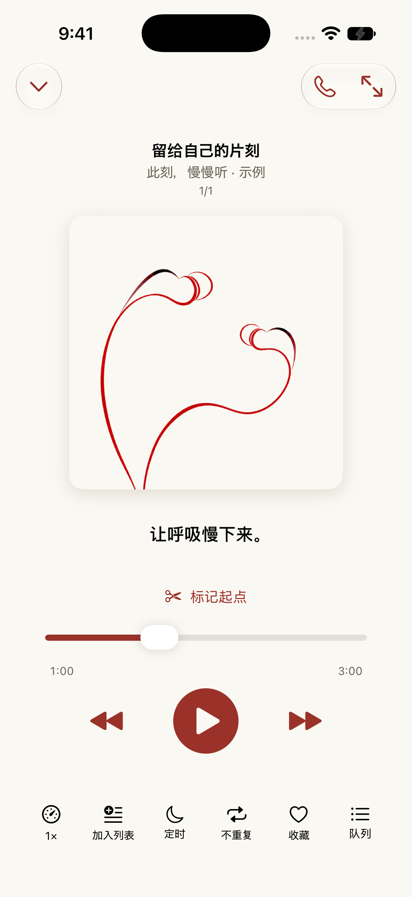
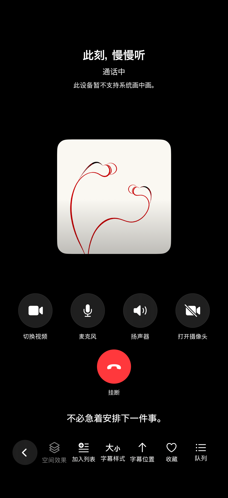
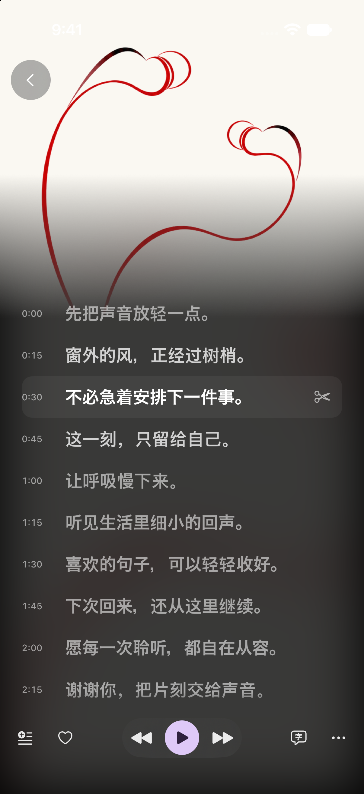
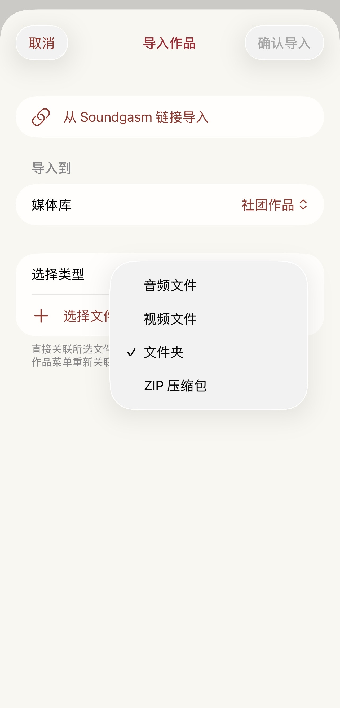
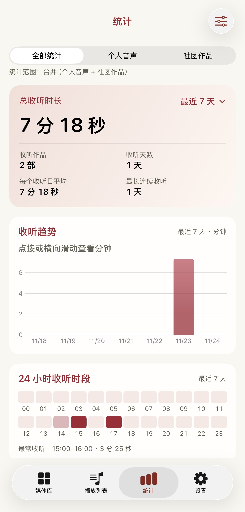
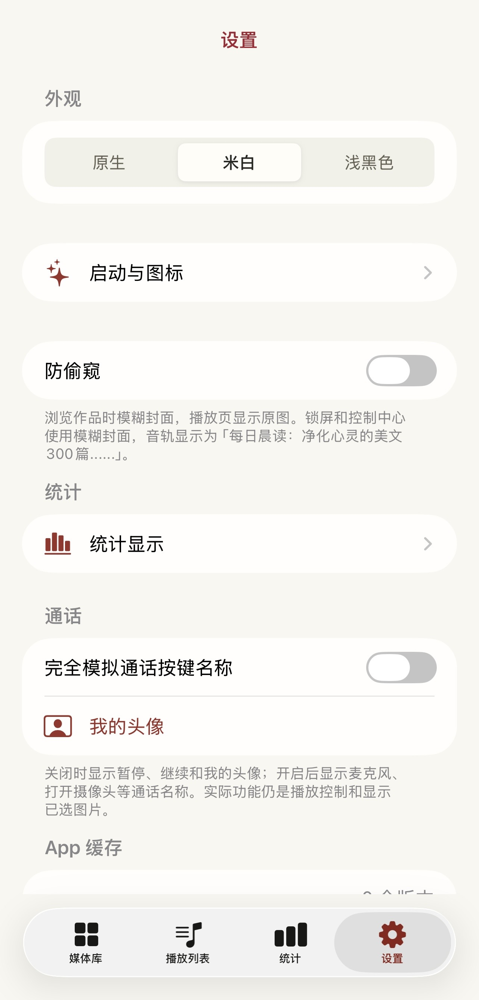
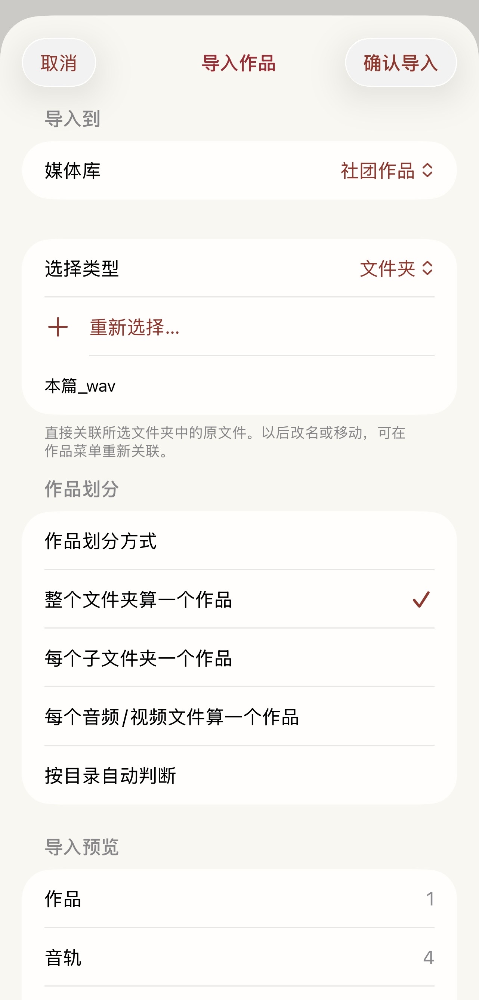
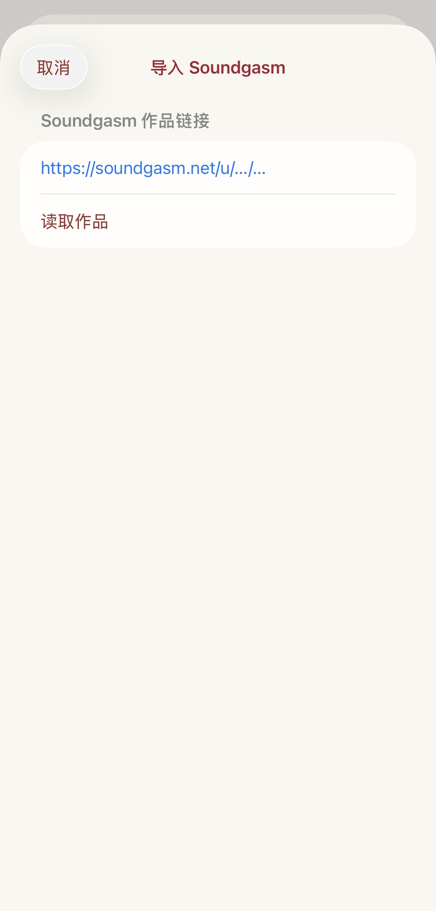
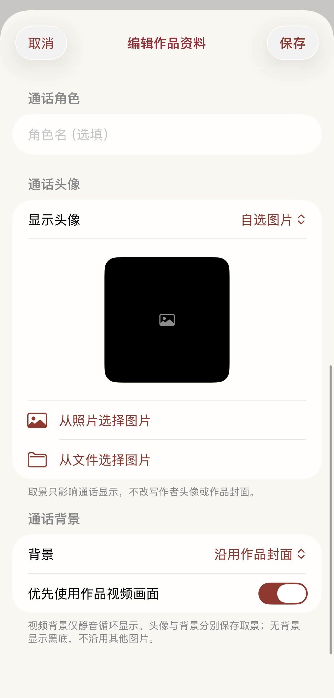
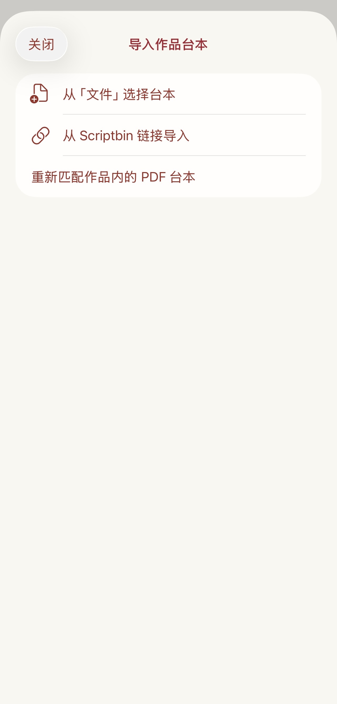

  

<h1 align="center">廝磨</h1>

<strong>把喜歡的聲音，整理成一座屬於自己的媒體庫。</strong>

個人獨立開發 · 全部功能免費 · 原始碼公開

| 穩定版 · v0.1.4（build 37） | 測試版 · v0.1.5（build 38） |
| --- | --- |
| 外放保護與背景恢復條件修正。 | 設定新增 NAS 存取（SMB / HTTP / WebDAV）與整庫備份、還原。 |
| **[下載穩定版 IPA](https://github.com/Reyanna0o0/Simo-soundplayer/releases/download/v0.1.4/simo-0.1.4-build37-unsigned.ipa)** | **[下載測試版 IPA](https://github.com/Reyanna0o0/Simo-soundplayer/releases/download/v0.1.5-beta.1/simo-0.1.5-build38-unsigned.ipa)** |
| [原始碼 ZIP](https://github.com/Reyanna0o0/Simo-soundplayer/releases/download/v0.1.4/simo-0.1.4-build37-source.zip) · [更新說明（簡中）](../../RELEASE_BUILD37.md) | [原始碼 ZIP](https://github.com/Reyanna0o0/Simo-soundplayer/releases/download/v0.1.5-beta.1/simo-0.1.5-build38-source.zip) · [更新說明（簡中）](../../RELEASE_BUILD38.md) |

兩個版本均為未簽名 IPA，需要自行簽名安裝；這是同一 App 的兩個版本選項。

**新版為測試版。還原備份會替換目前整個媒體庫，不會合併。完整真機還原與家庭 NAS 使用仍未完成驗收。** 請保留重要原始檔案與現有 App。[測試版範圍與限制（簡中）](../../RELEASE_BUILD38.md)

[安裝教學](INSTALL.md) · [版本更新](https://github.com/Reyanna0o0/Simo-soundplayer/releases)

iOS / iPadOS 18 或更新版本

<a href="../../../README.md">简体中文</a> · <strong>繁體中文</strong> · <a href="../en/README.md">English</a> · <a href="../ja/README.md">日本語</a> · <a href="../ko/README.md">한국어</a>

廝磨是一款以作品整理與沉浸式播放為核心的 iOS 音聲播放器。個人音聲與社團作品分庫管理，音訊、影片、封面、台本與聆聽紀錄集中在同一個地方。無需註冊帳號，匯入自己的收藏，就能開始聆聽。

> **v0.1.4 · build 37：加入外放保護，並收緊背景恢復播放。** 內建揚聲器預設靜音，可在播放時調整系統音量或連接耳機解除；在背景被其他聲音中斷後保持暫停，需主動繼續。沿用原帳號與簽名設定覆蓋安裝，**請勿先移除舊版**。 [更新說明（簡中）](../../RELEASE_BUILD37.md)

## 從匯入到聆聽，只需三步

| 匯入作品 | 整理作品 | 開始聆聽 |
| --- | --- | --- |
| 選取音訊、影片、資料夾、ZIP，或貼上 Soundgasm 單一作品連結。 | 按資料夾與檔案劃分作品，補充封面、創作者、台本與分類。 | 在一般播放、通話外觀與全螢幕字幕之間，找到舒服的聆聽方式。 |

## 三種方式，陪你聽喜歡的聲音

<table>
  <tr>
    <th align="center">一般播放</th>
    <th align="center">沉浸通話</th>
    <th align="center">全螢幕字幕</th>
  </tr>
  <tr>
    <td align="center"></td>
    <td align="center"></td>
    <td align="center"></td>
  </tr>
  <tr>
    <td valign="top">播放速度、音調、等化器、循環、睡眠計時與佇列，也能在背景和鎖定畫面控制播放。</td>
    <td valign="top">依作品設定角色、頭像與背景，切換語音或視訊通話外觀，讓畫面更貼合作品。</td>
    <td valign="top">邊聽邊讀，調整原文與譯文的顯示；也能編輯字幕、手動設定時間軸或開啟字幕浮窗。</td>
  </tr>
</table>

三張範例均為模擬器中的 App 實拍，使用虛構作品與原創示範內容，不引用實際音聲作品。子母畫面的可用性取決於裝置；通話圖保留了模擬器的系統提示。通話外觀用於本機媒體播放，不會發起真實通話；此模式不提供播放速度等一般播放器調整功能。[播放與通話說明（簡中）](../../USAGE.md#播放与通话)

## 讓收藏有條理，讓習慣看得見

<table>
  <tr>
    <th align="center">從不同來源匯入</th>
    <th align="center">記錄自己的聆聽軌跡</th>
    <th align="center">依自己的習慣使用</th>
  </tr>
  <tr>
    <td align="center"></td>
    <td align="center"></td>
    <td align="center"></td>
  </tr>
  <tr>
    <td valign="top">音訊、影片、資料夾與 ZIP 都能匯入。確認前預覽作品與音軌，選擇儲存至個人音聲或社團作品。</td>
    <td valign="top">查看總時長、作品數、聆聽天數、每個聆聽日的平均時長與連續紀錄。兩個媒體庫可分開或合併統計，時長保留秒數。</td>
    <td valign="top">原生、米白、淺黑色、紫色四種外觀；可調整啟動圖示、啟動音效、統計顯示與通話按鍵名稱。</td>
  </tr>
</table>

設定截圖展示前三個外觀選項，紫色可橫向滑動選取。防窺模式會模糊瀏覽時的封面，並在鎖定畫面和控制中心模糊封面、替換音軌標題及隱藏作品／作者資料；播放頁仍顯示原圖。

### 外放前，多一層確認

**外放保護預設開啟**，可在「設定 → 外放保護」關閉。使用裝置內建揚聲器時，一般音訊、影片、通話與開屏語音先保持靜音；播放時調整系統音量、點「允許本次外放」，或將輸出切換到耳機即可解除。暫停後重新播放或切回揚聲器時再次保護。它只靜音廝磨，不改系統音量，也不會讓已暫停的內容自動播放。音量已在最高或最低、按鍵沒有改變音量時，可使用「允許本次外放」。

App 在背景或非活動狀態時，中斷結束後保持暫停，需主動播放。前景僅在先前正播放同一曲目、期間未手動暫停且系統允許時恢復。[使用說明](../../USAGE.md#speaker-protection-translations)

### 一個資料夾，多種整理方式

資料夾與 ZIP 匯入支援四種作品劃分：**整個資料夾、每個子資料夾、每個音訊／影片檔案，或按目錄自動判斷**。個別選取音訊或影片時，每個檔案建立一部作品。

單獨匯入的音訊與影片會複製到 App；資料夾匯入則保留外部關聯。外部資料夾改名或移動後，可在作品選單重新關聯新位置，繼續使用既有資料與字幕版本。[匯入與重新關聯（簡中）](../../USAGE.md#导入作品)

查看作品劃分與匯入預覽

### 連結裡的聲音，也能收進媒體庫

貼上 **Soundgasm 單一作品連結**，讀取並確認資料，再下載音訊副本。儲存後的音訊可離線聆聽；讀取網頁與下載時需要連網。[連結匯入步驟與支援範圍（簡中）](../../USAGE.md#从链接导入)

查看 Soundgasm 匯入入口

### 讓播放畫面更貼合作品

除了作品封面，也能分別設定**通話角色、頭像、背景與取景**。沿用封面、自選圖片，或優先使用作品中的影片畫面；頭像與背景分別儲存，不改寫原作品封面。影片背景以靜音循環顯示，靜態背景還可啟用在裝置上處理的空間效果。

查看頭像與背景設定

### 把台本和作品放在一起

從「檔案」選取台本、從 **Scriptbin** 連結擷取並確認正文，或重新配對作品內的 PDF。帶有時間標記的 SRT、LRC 等字幕可跟隨播放；沒有時間標記的台本可直接閱讀，也能逐句手動設定時間軸，編輯後會儲存為新版本。

若同時匯入原文與譯文，就能配對並上下顯示。**廝磨不提供自動翻譯，原文與譯文由你匯入。** [台本、字幕與時間軸（簡中）](../../USAGE.md#字幕与台本)

查看台本匯入入口

### 留下喜歡的片段，也留下聆聽的足跡

把準備連續聆聽的曲目加入播放列表，用剪刀標記喜歡的起點與終點，儲存為獨立摘選；片段可保留字幕、拼接，並匯出 MP3 或 WAV。列表與分類支援排序和移動。

月度回顧與年度報告整理聆聽時長、足跡和排行，也能匯出連續長圖，保存屬於自己的聆聽紀錄。

[播放列表與摘選（簡中）](../../USAGE.md#播放列表与摘选) · [統計與報告分享（簡中）](../../USAGE.md#统计外观与语言)

## 全部功能免費，原始碼公開

廝磨的全部功能對個人非商業使用免費開放。你可以自願贊助開發；贊助不會解鎖額外權益、專屬功能或付費內容，也不代表取得商業授權。

**[透過 Stripe 支持](https://donate.stripe.com/7sYcN4ctY5GM3rK3oM7ok00) · [透過愛發電支持](https://afdian.com/a/Reyanna0o0)**

專案採用自訂的**廝磨播放器非商業原始碼授權協議 1.0**，並非 MIT、GPL 或 OSI 認證的開源授權。可依協議免費使用、修改與分享；分享修改版須保留署名、提供完整對應原始碼並標示非官方。所有商業使用須事先取得書面同意。[授權全文（以中文原文為準）](../../../LICENSE) · [商業授權（簡中）](../../COMMERCIAL_USE.md)

## 安裝與更新

目前透過自行簽名的方式安裝，並非從 App Store 下載。

1. 在電腦上[下載 IPA](DOWNLOAD.md)，準備 Sideloadly 等簽名工具與自己的 Apple 帳號。
2. 使用傳輸線連接 iPhone / iPad，依照[安裝教學（簡中）](../../INSTALL.md)完成簽名與安裝。
3. 若系統提示，前往「設定 → 一般 → VPN 與裝置管理」信任開發者，並依教學開啟開發者模式。

更新或續簽時，沿用原 Apple 帳號、App 識別碼與簽名設定覆蓋安裝，**保留原 App，請勿先移除舊版**。簽名有效期限、續簽與各種安裝方式的注意事項，請參閱完整說明。

[下載協助（簡中）](../../DOWNLOAD.md) · [安裝、續簽與更新（簡中）](../../INSTALL.md) · [對應原始碼 ZIP](DOWNLOAD.md) · [實際驗證範圍（簡中）](../../RELEASE_STATUS.md)

## 資料與內容由你掌握

媒體庫、字幕版本、播放列表、摘選與聆聽紀錄保存在裝置上，沒有由專案提供的雲端媒體庫或跨裝置同步。連結匯入需要存取相關網站；iCloud Drive、系統備份與匯出至雲端硬碟，由系統及服務提供者依你的設定處理。

請另外保存重要的原始檔案。安裝檔不附帶音聲作品或台本，範例截圖也不代表附贈內容；請匯入你有權使用的媒體，分享摘選、字幕或報告時留意其中的作品資料。[檔案保留與快取（簡中）](../../USAGE.md#缓存与数据保留)

## 意見回饋與後續計畫

發現 Bug，或對功能與介面有新的想法，歡迎透過 [GitHub Issues](https://github.com/Reyanna0o0/Simo-soundplayer/issues) 回饋。請描述裝置系統、App 版本與重現步驟，截圖中請遮住私人作品與帳號資訊。[回報 Bug](https://github.com/Reyanna0o0/Simo-soundplayer/issues/new?template=bug-report.yml)

目前提供 iOS / iPadOS 版本。後續更新與 Android 適配計畫會在 GitHub 記錄，**Android 版尚無發布時程**。點擊 **Star** 收藏專案；若需要更新通知，可在 **Watch → Custom → Releases** 訂閱發行版。

想參與改進，可以先閱讀[建置說明（簡中）](../../BUILD.md)、[驗證紀錄（簡中）](../../RELEASE_STATUS.md)與[歷次修復說明（簡中）](../../AI_REVIEW_FIXES.md)，透過 Issues 交流後提交修改。

開發目錄與素材署名

| 目錄 | 用途 |
| --- | --- |
| `SituationVoicePlayer/` | SwiftUI App、資源與 Xcode 專案 |
| `hibiki/` | HibikiCore、資料庫、字幕邏輯與自我檢查 |
| `ThirdParty/` | 第三方原始碼、模型來源與授權 |
| `scripts/` | 資源核對、建置、測試與 IPA 打包 |
| `tools/localization/` | 既有五語翻譯目錄與產生工具 |

圖示與啟動畫面的創意來自 Reyanna0o0，手繪修改由友人協助並已授權，底圖與動畫由 ChatGPT 協助製作。展示截圖與範例內容的來源另有記錄，不使用真實音聲作品作為示範。

第三方元件保留各自授權；適用的 LGPL 修改、除錯、替換與重新連結權利也予以保留。散布含 LGPL 元件的安裝檔時，請同時提供對應原始碼與重建材料。

[素材說明（簡中）](../../ASSETS.md) · [第三方材料（簡中）](../../THIRD_PARTY.md) · [商業授權申請](https://github.com/Reyanna0o0/Simo-soundplayer/issues/new?template=commercial-license.yml) · [開發者信箱](mailto:sumo-soundplayer@outlook.com)

---

<strong>把喜歡的聲音，收進廝磨。</strong>

<a href="DOWNLOAD.md">下載 IPA</a> · <a href="../../INSTALL.md">查看安裝教學</a> · <a href="https://github.com/Reyanna0o0/Simo-soundplayer">在 GitHub 收藏專案</a>

